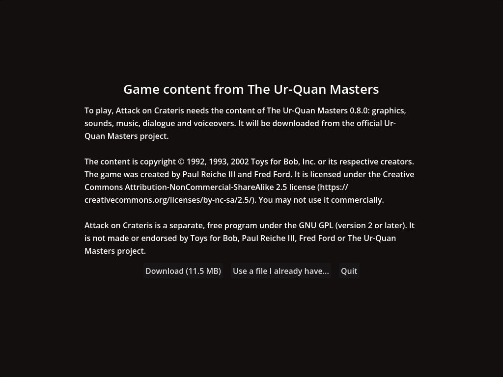
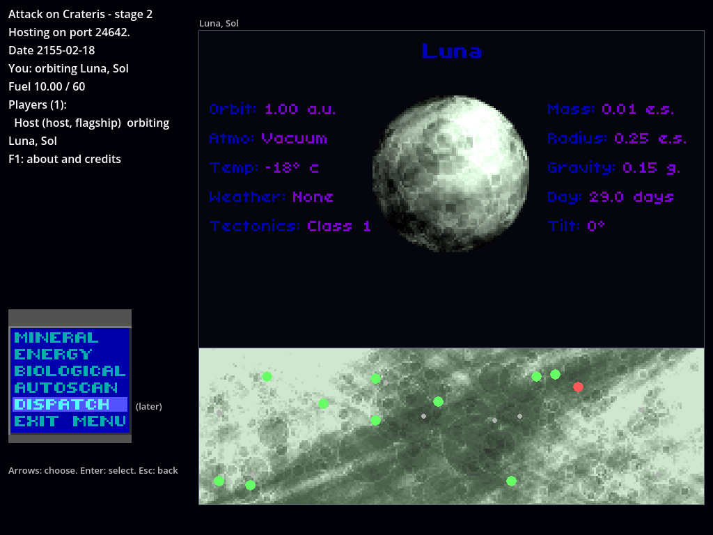
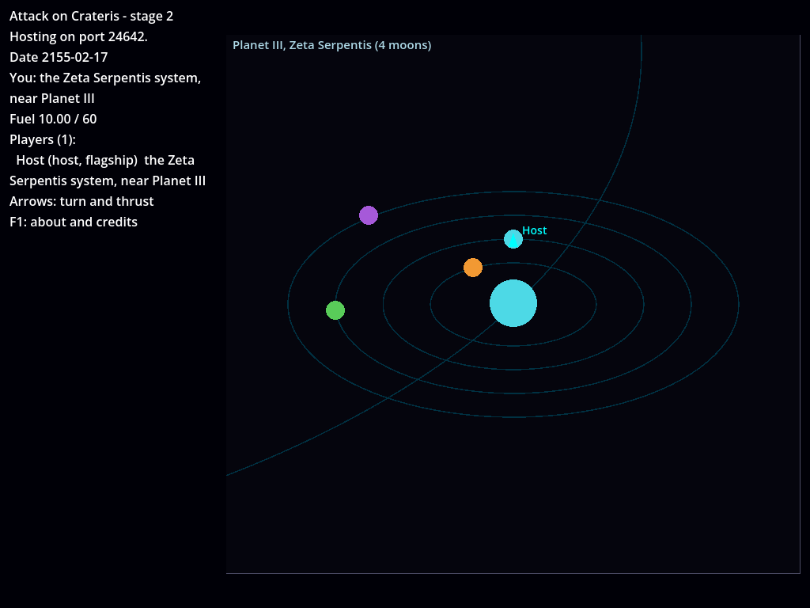
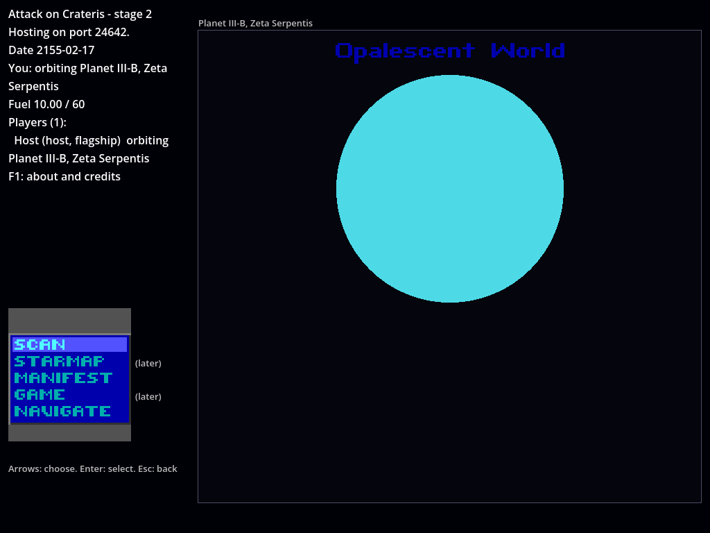
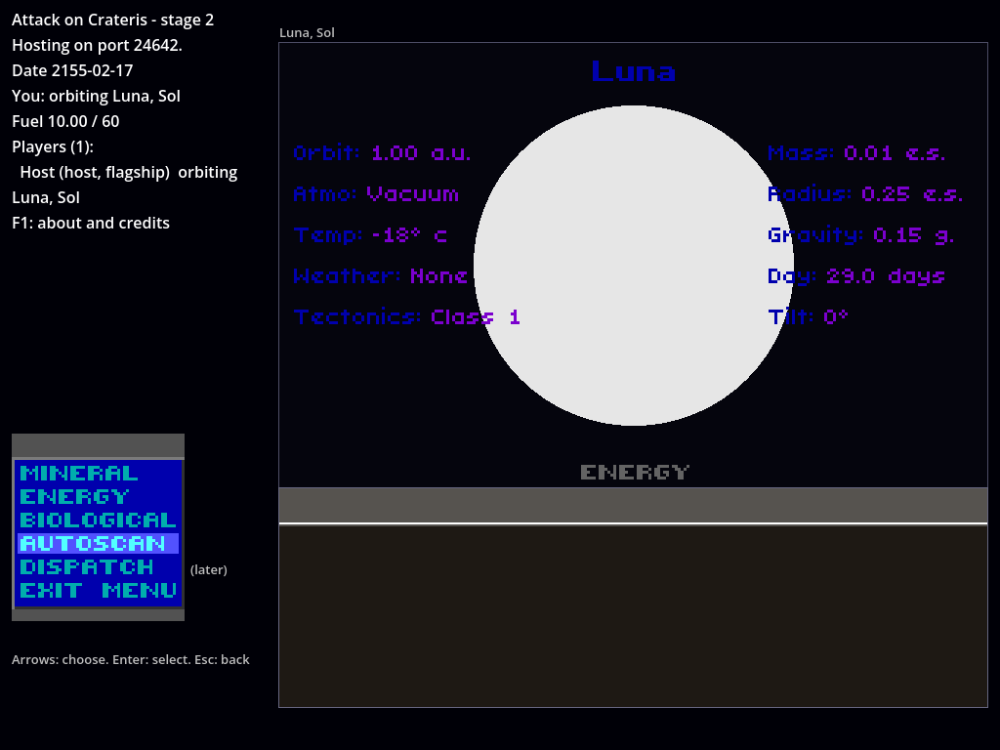
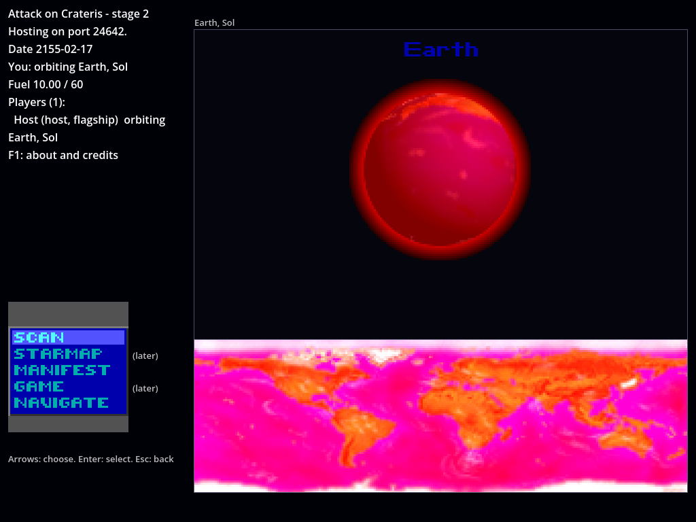
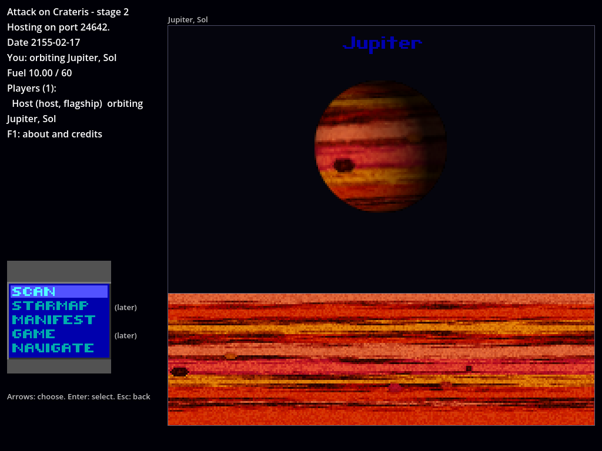

# How to try it: the content stage (in progress)

The content stage is being built in the order of `docs/plans/content-stage.md`. This page grows with it.





## So far: getting the content

Items 1 to 3 are built. The engine opens the official UQM 0.8.0 content package (`uqm-0.8.0-content.uqm`) in place, refuses any file that isn't the official one (by its SHA-256), and reads files from it by path or by UQM's resource ids. On first start, it asks for the package.

### Try it in the game

To see the first-run screen again, move the game's copy away first: it's `content/uqm-0.8.0-content.uqm` in Godot's user folder (`~/.local/share/godot/app_userdata/Attack on Crateris/` on Linux).

1. Start the game (`godot --path game`). The content screen shows the notice, **Download (11.5 MB)**, **Use a file I already have...** and **Quit**. No "I agree": the license doesn't ask for one.
2. **Download** fetches the package from the UQM project's SourceForge page, with a progress bar, checks it and starts the game. Start again and it goes straight in.
3. Or **Use a file I already have...** and pick a `uqm-0.8.0-content.uqm` you have (from an installed UQM 0.8.0, say). It's checked and copied in; your own file is left alone.
4. A file that isn't the official package is refused with a message saying so, and nothing is kept. If the download fails (no connection, no answer, or nothing arriving for 30 seconds), it says why and you can try again. **Cancel** stops a download or copy part way.
5. In the game, **F1** shows the about screen with the content notice; F1 or Esc closes it.

A headless host or guest (servers, tests) needs the package given: `--content PATH` (the file or its folder) or `CRATERIS_CONTENT`. Without one it stops at once and says so.

### Run the tests

```
dotnet test --filter "ContentPackageTests|ResourceIndexTests|ContentInstallerTests|StringTableTests"   # 25 tests
python3 tools/test_network.py
```

`ContentInstallerTests` downloads from a small web server the test runs itself (with redirects, as SourceForge does), and checks a good download is kept unchanged, a wrong one isn't kept and the old copy stays, failures say why (no answer, an error from the server, a dropped connection, nothing arriving for 30 seconds, a folder that can't be written), a download cancelled before or part way leaves nothing behind, a file the player has is checked before it's copied, and a package in use can be replaced. `TheNoticeIsTheOneInTheDesign` keeps the game's notice the same as the one quoted in `docs/design.md`, so a change to the wording goes in the design first.

The test that reads the real package is skipped without it, and says so. To run it, point the tests at the package (the game's own copy is found by itself):

```
CRATERIS_CONTENT=~/Downloads/uqm-0.8.0-content.uqm dotnet test
```

(`CRATERIS_CONTENT` can also name the folder the file is in. If it names a file that doesn't exist, the test fails and says so, rather than being skipped.) What should happen: all tests pass, none skipped. `TheOfficialPackageOpensAndEveryIndexedFileIsInIt` checks the file is the official one and that every one of the 963 entries in its resource index names a file in it.

`StringTableTests` checks UQM's string tables are read exactly as UQM's own loader reads them: odd inputs written for the test, byte for byte, and every one of the 51 string tables in the package (by hash, since the text is content). With the package it also reads a few you'd recognise: "Vega" (the first star string), "Orbit: " (the planet report's first label), "Earth" and "Luna".

The network test needs the package too, the same way; it also checks that a headless host without it stops and says how to give it one.

The package is never added to the repository.

## So far: names

Item 4 is built. Stars, planets and moons have their UQM names, made by the same code UQM uses:

- A star is its constellation name, with a Greek letter in front if it has one ("Zeta Serpentis", "Sol").
- Sol's planets and its named moons have their own names (Earth, Luna, Titan), as do the Starbase and the Sa-Matra. Every other planet is "Planet I", "Planet II"… by its place from the sun, and an unnamed moon is its planet's name with "-A", "-B"… after it ("Planet III-B").
- The orbit screen's title is UQM's: a world's own name, or its type ("Opalescent World", "Gas Giant").

### Try it in the game

1. Start as a host in orbit around Luna: `godot --path game -- --host --start-orbit 82:2:1`. The orbit screen's title is "Luna", with "Luna, Sol" just above the screen, and the status on the left says "orbiting Luna, Sol".
2. Choose Navigate to leave orbit: the inner system view's title is "Earth, Sol (2 moons)" and the status says "the Sol system, near Earth".
3. Fly out of the inner system: the outer view's title is "Sol" with its coordinates.
4. Try an ordinary star: `--start-orbit 0:2:1` is "Opalescent World", "Planet III-B, Zeta Serpentis"; leaving orbit shows "Planet III, Zeta Serpentis (4 moons)".
5. With a guest joined, each player's line in the status shows where they are by name too.



Since item 5, the title is drawn in UQM's own font (below).

### Run the tests

```
CRATERIS_CONTENT=~/Downloads/uqm-0.8.0-content.uqm dotnet test --filter NamesTests   # 4 tests
```

`EveryNameIsTheNameUqmGives` checks the name of every one of the 502 stars and the names and titles of every planet and moon against what UQM's own code gives (by hash, as names are content). Two more check a few you'd recognise in plain words: Sol, Earth, Luna and Titan, and "Planet ..." and "-B" for an ordinary system. `NamesAreMadeOnceAndKept` checks names are made once and kept, since the views ask for them every frame. Without the package they're skipped, and say so.

## So far: the orbit screen's words and fonts

Item 5 is built. The orbit screen now shows UQM's own words in UQM's own fonts, where UQM's PC version puts them:

- the title ("Luna", "Opalescent World") centred at the top, in UQM's small title font;
- the planet report in UQM's tiny font, labels in dark blue and values in purple, at UQM's positions: "Orbit: 1.00 a.u.", "Atmo: Vacuum", "Temp: -18° c", "Weather: None", "Tectonics: Class 1" on the left, "Mass:", "Radius:", "Gravity:", "Day:", "Tilt:" on the right;
- the menus as UQM's PC menu box, in its font and colours: "scan, starmap, manifest, game, navigate" and "mineral, energy, biological, autoscan, dispatch, exit menu" (the font has only capitals, so they show in capitals, as in UQM). Entries that come later are marked "(later)" beside the box;
- while a scan is drawn, its name above the scan map, in the menu's words (UQM shows only the colour).

Our own text stays in the engine's font: the status on the left, the world and star above the screen, messages and key hints.





### Try it in the game

1. `godot --path game -- --host --start-orbit 82:2:1`: the menu box shows "SCAN, STARMAP, MANIFEST, GAME, NAVIGATE", with "(later)" beside Starmap and Game.
2. Choose Scan: the report appears around the planet, and the menu shows the scan entries. Choose an entry that comes later (Dispatch): the message under the box says so.
3. Choose Autoscan: each scan's name shows above the map while it's drawn.
4. Compare with UQM 0.8.0 (PC menus): the words, colours, letter shapes and spacing should match; the screen is three times UQM's size.

### Run the tests

```
CRATERIS_CONTENT=~/Downloads/uqm-0.8.0-content.uqm dotnet test --filter "FontTests|OrbitScreenTextTests"   # 11 tests
```

`EveryFontLoadsAsUqmLoadsIt` checks all 29 fonts of the package (32 font resources; some share a font), every one of their 2,503 characters (size, position and every pixel), against what UQM's own font loader makes of them. `TextIsLaidOutAsUqmLaysItOut` checks 1,341 texts laid out in the three fonts the orbit screen uses, against UQM's own layout code: texts of our own that test each odd case (alignment, missing characters, bad UTF-8, UQM's limit of 100 characters) and every menu entry, report label and world type in the game strings. Both use hashes, since fonts are content. `ImagesOfOurOwnLoadAsUqmLoadsThem` and `EveryKindOfImageInThePackageLoadsAsUqmLoadsIt` check the image reader against UQM's own PNG loader: images made for every case it handles (transparency, palettes, interlacing, 16-bit images) and up to 40 of each kind of image in the package. `NumbersAreWrittenAsUqmWritesThemInAnyLocale` checks the report reads "-18° c" even on a computer set to Swedish. `OrbitScreenTextTests` checks the menu numbering against UQM's `menustat.h`, the menu words, and the report and menu box at UQM's positions.

## So far: planet surfaces

Item 6 is built. Every world you can orbit now shows its own surface map below the planet, as UQM makes it: the same terrain, craters, gas giant bands and storms, in the same colours. Earth shows its own map. Worlds under a shield (Earth in a new game) show the map with the shield's red added, as UQM does. Scans now tint the map as UQM does, by adding the scan's colour to it.

Since item 7, the planet above the map turns, as below.



### Try it in the game

1. `godot --path game -- --host --start-orbit 82:2:1` (Luna): a grey cratered map below the planet. Choose Scan, then Autoscan: each scan tints the map from the top down as it's drawn.
2. `--start-orbit 82:3` (Mars): rust red, with a great dark scar across it. `--start-orbit 82:4` (Jupiter): bands and storms.
3. `--start-orbit 82:2` (Earth): Earth's own map, all reddish because of the shield around it.
4. Any world: compare with UQM 0.8.0 orbiting the same world. The maps should be identical, pixel for pixel, at three times UQM's size.

### Run the tests

```
dotnet test --filter SurfaceMapTests   # 2 tests, a few seconds; no content needed
CRATERIS_CONTENT=~/Downloads/uqm-0.8.0-content.uqm dotnet test --filter PlanetSurfacesTests   # 5 tests, about 10 seconds
```

`EveryWorldsHeightMapIsTheOneUqmMakes` makes the height map of every one of the 3,799 worlds that can be orbited (all but Earth) and checks each against what UQM's own generator makes of it. That needs no content: the terrain is made by code alone. `AFewWholeMapsMatchPointForPoint` compares three whole maps point by point, so a difference shows where it is. `EveryWorldsColouredMapIsTheOneUqmDraws` checks every world's coloured map against UQM's own drawing code with the package's colour tables (by hash). `EveryBinaryTableIsReadAsUqmReadsIt` checks all 149 of the package's binary tables against UQM's reader. The rest check Earth's own map, the shield's red, and UQM's additive blending sums.

## So far: the rotating planet

Item 7 is built. In orbit, the world turns above its map as in UQM: its own surface wrapped round a sphere, tilted by its axial tilt, lit from the side its sun is on (a moon by its planet's sun), with its relief shading the light. It turns one map column at a time, a full turn every 12 seconds, east or west depending on its tilt. A shielded world (Earth in a new game) is drawn reddened inside UQM's red halo.

UQM's own planet drawing is used throughout, with UQM's default (PC) shield, which glows steadily; the 3DO option's pulsing shield isn't ported. The zoom of the planet onto the screen as orbit starts isn't either: the planet is simply there, already turning.



### Try it in the game

1. `godot --path game -- --host --start-orbit 82:4` (Jupiter): its bands and great storm turn across the sphere.
2. `--start-orbit 82:2` (Earth): red under its shield, with the halo round it.
3. `--start-orbit 82:2:1` (Luna), then a planet of another system: worlds lit from different sides, depending on where their sun is.
4. Compare with UQM 0.8.0 orbiting the same world: the planet should look the same, at three times UQM's size. (UQM's planet starts a little further round, after its zoom-in.)

### Run the tests

```
dotnet test --filter EveryWorldsLightMapIsTheOneUqmMakes   # no content needed
CRATERIS_CONTENT=~/Downloads/uqm-0.8.0-content.uqm dotnet test --filter PlanetSphereTests   # 3 tests
```

`EveryWorldsLightMapIsTheOneUqmMakes` checks the light map (the relief shading) of all 3,799 generated worlds against UQM's own code. `TheRotatingPlanetIsDrawnAsUqmDrawsIt` checks UQM's own drawing of the planet, for the first world of each planet type with and without a shield (61 worlds), at six points of its turn, pixel for pixel (by hash), and the shield's halo. `ItTurnsAsUqmTurnsIt` checks the direction, the steps and the place on screen.
