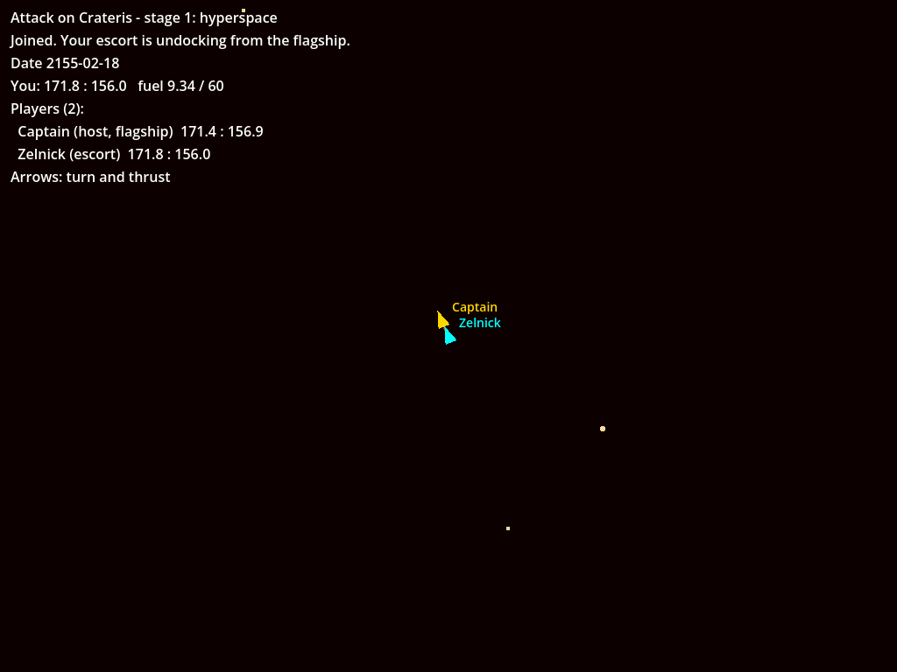

# How to try it: stage 1, flying in hyperspace together

Stage 1 is players flying around hyperspace together, joining and leaving at will. There's no UQM content yet (the first-run download comes later), so the view is a placeholder: stars are dots, ships are triangles with names.



## Set up (once)

On Linux, install the .NET 8 SDK and Godot 4.7.2 .NET:

```
sudo tools/setup-toolchain.sh
```

It puts `dotnet` and `godot` in `/usr/local/bin`. If you already have them, any .NET 8+ SDK and the Godot **4.7.2 .NET** build work.

Then build:

```
dotnet build game/Crateris.Game.csproj
godot --headless --import --path game
```

## Run the tests

```
dotnet test                                    # 26 core tests at stage 1; later stages add more (see their pages)
python3 tools/test_network.py                  # real host and guests, about 20 s
python3 -m unittest discover -s tools/extract  # data checks
```

What should happen: `dotnet test` reports 26 passed at stage 1, and more after later stages (108 after stage 2), all passing. The network test prints a list of `ok` lines ending in "all network checks passed".

## Play it

**Solo (you are the host):** open the project in the Godot editor (`godot --path game`) and press Play, or run `godot --path game`. Fly with the arrow keys: left and right turn, up thrusts.

What should happen:

- Your ship (cyan triangle) starts at Sol, 175.2 : 145.0, with 10.00 fuel of 60.
- Thrusting moves you across the stars and burns fuel: about 0.1 per map unit, as in UQM.
- Letting go of thrust slows you to a stop, as UQM's flagship does in hyperspace.
- The date at the top advances one day every 5 seconds. That's a placeholder rate; the real one is still to be set.
- Turning and top speed feel like UQM's starting flagship. They come from the same code, checked frame by frame.

**With a friend:** the host runs `godot --path game -- --host`, and the friend runs `godot --path game -- --join HOST_ADDRESS`. The port is 24642 (UDP). The host's game asks the router to open it (UPnP) and shows the address to share in the top-left. If that fails, forward UDP 24642 on the host's router, or use Tailscale or ZeroTier and join with the host's private address.

To try it on one machine, open two terminals:

```
godot --path game -- --host --name Host
godot --path game -- --join 127.0.0.1 --name Guest --id guest-1
```

What should happen:

1. The guest's window says "Joined. Your escort is undocking from the flagship." and shows "Undocking from Host's flagship..." for 2 seconds. Their escort (cyan) appears at the host's flagship (gold).
2. Each player flies their own ship and sees the other move.
3. Close the guest's window. The guest's ship disappears from the host's view.
4. Start the guest again with the same `--id`. It says "Welcome back", with no undocking, and the ship is where it was left, stopped.
5. Close the host's window. The game is saved to Godot's user folder (`~/.local/share/godot/app_userdata/Attack on Crateris/host-save.json` on Linux). Starting the host again continues the saved game, and the guest can rejoin.
6. A fifth player trying to join is told "The game is full (4 players)."

Without `--id`, each machine makes up its own player id once and keeps it in the same user folder, so rejoining just works.

## Known limits of stage 1

- **No UQM content:** no star names, ship art or sound.
- **Hyperspace only:** no solar systems, QuasiSpace, encounters or autopilot. The flagship starts in hyperspace at Sol, rather than inside the Sol system as in UQM.
- **Placeholder escort:** a guest's escort has the flagship's starting drives, one fuel tank and 10 fuel, until the escort module set is decided.
- **Placeholder undocking scene:** a 2-second message.
- **No pause or chat yet.**

## Bugs

Send the error text, a screenshot and what you expected. The host's and guest's terminals print what they did. Add `--report FILE` to get it as JSON.
