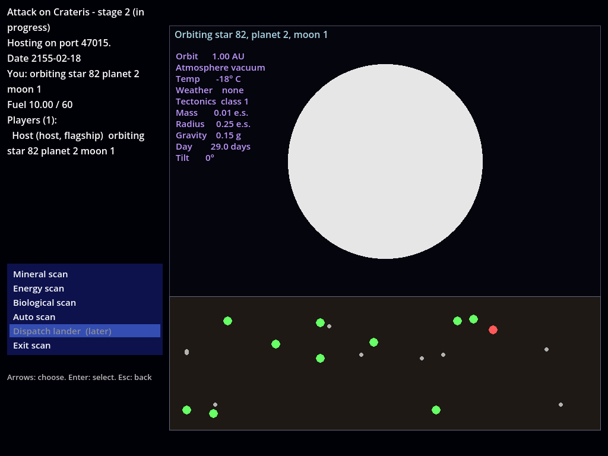
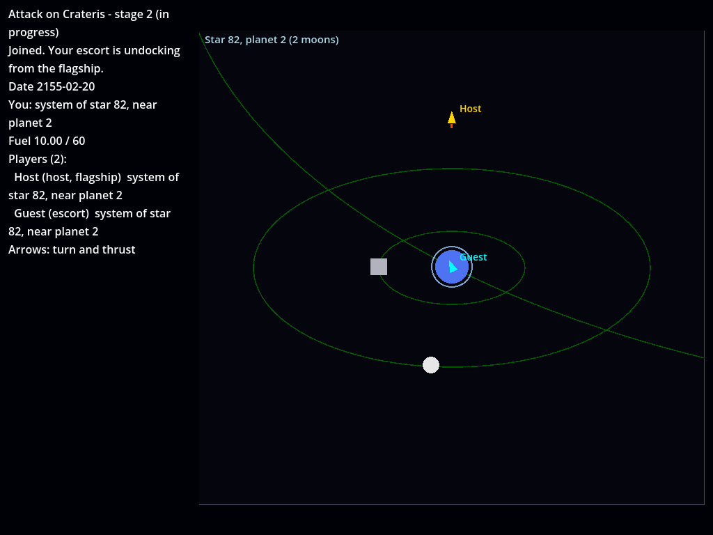
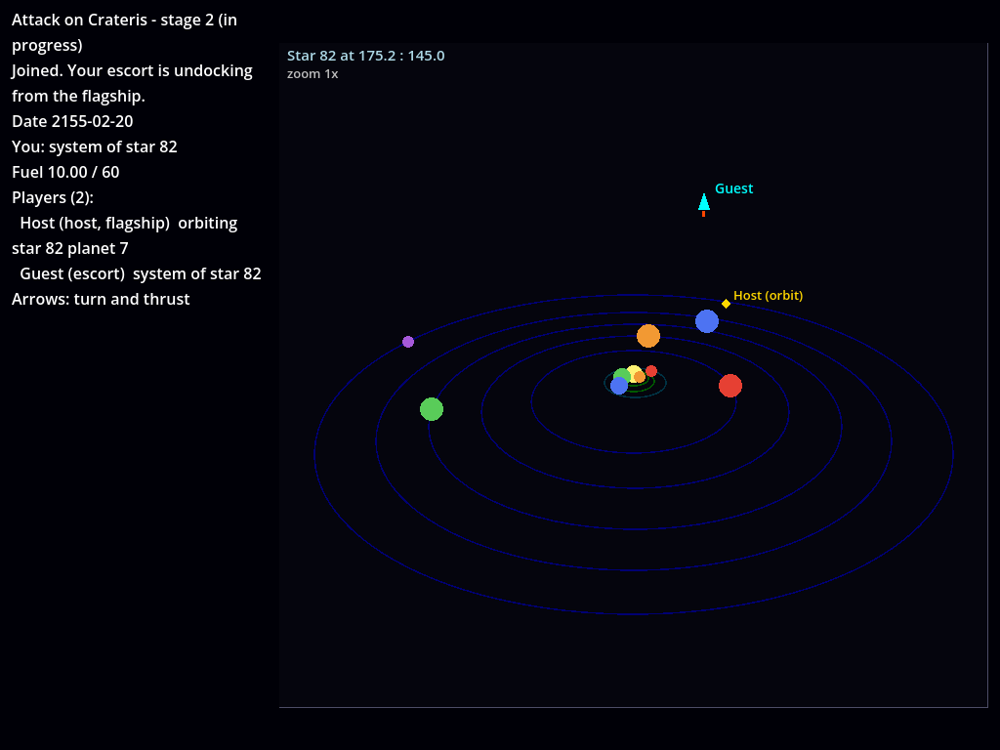
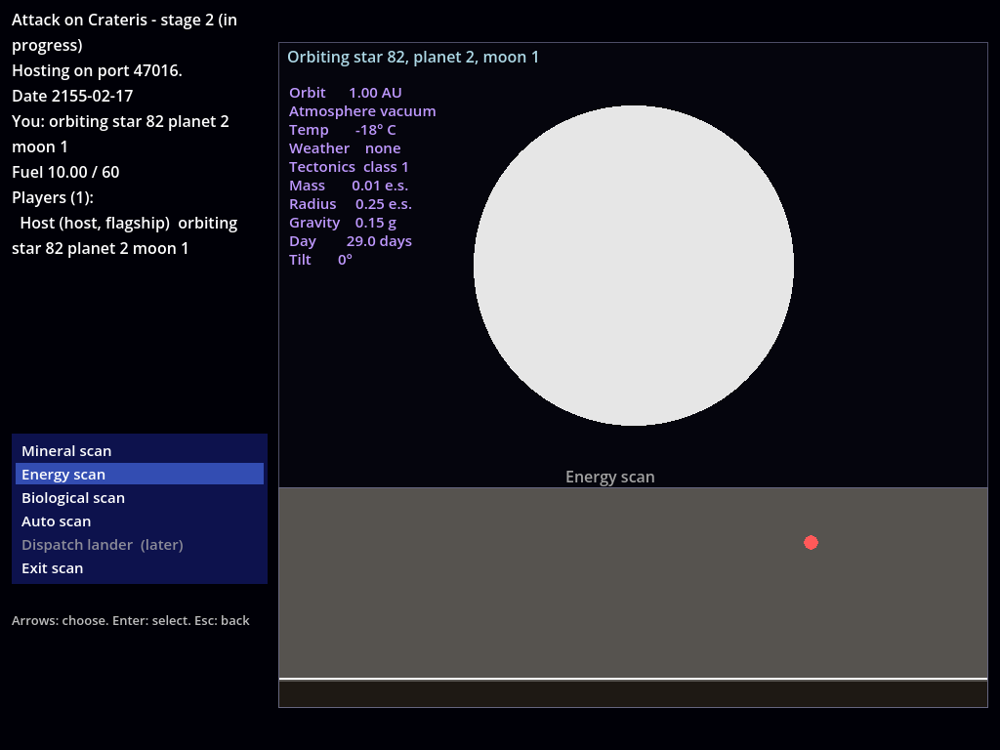

# How to try it: stage 2, solar systems and planets

Stage 2 adds star systems. Fly from hyperspace into any of the 502 stars, around its planets and moons, into orbit, and back out, alone or with friends. Every planet and moon, each world's planet report and its mineral, energy and life nodes are generated from the star's seed exactly as UQM 0.8.0 generates them. The plan, with every decision, is `docs/plans/stage-2.md`.

There's still no UQM content (the first-run download is the next stage), so the drawing is a placeholder: worlds are plain circles in a colour for their kind, the planet report's labels are our own wording, and scan dots are coloured circles. Positions, sizes, orbit colours, the menus and the timing of the scan are UQM's.



## Set up

As for stage 1 (`docs/how-to-try/stage-1.md`): install the toolchain once, then

```
dotnet build game/Crateris.Game.csproj
godot --headless --import --path game
```

## Run the tests

```
dotnet test                                    # 108 core tests
python3 tools/test_network.py                  # real host and guests, about 30 s
python3 -m unittest discover -s tools/extract  # data checks
```

What should happen: `dotnet test` reports 108 passed. The network test prints `ok` lines ending in "all network checks passed"; its last part has a guest join while the host orbits the Moon, the host auto-scan it (9 mineral, 1 energy and 10 life nodes) and leave orbit through the menu.

## Play it

**Since the content stage** the game needs the UQM 0.8.0 content to host or join: the first start shows the content screen (Download, or use a file you already have), once. The network test needs it too: start the game once with a window, or set `CRATERIS_CONTENT` to the package (`docs/how-to-try/content-stage.md`).

### Keys

- **Flying** (hyperspace and systems): left and right turn, up thrusts.
- **In orbit:** up and down (or left and right) move through the menu, Enter or Space selects, Esc or Backspace goes back.

### Solo: Sol, Earth and the Moon

Start a new game as host (`godot --path game`, or Play in the editor). Delete `host-save.json` in Godot's user folder first if you want a new game rather than your saved one (`~/.local/share/godot/app_userdata/Attack on Crateris/` on Linux).

1. You start in hyperspace on Sol. Thrust away for a second, turn round and fly back onto Sol. You arrive at the bottom middle of Sol's outer view, facing up: the sun in the middle, the nine planets on their orbits (coloured by temperature, blue for cold to orange for hot), as in UQM. The top-left of the system screen says "Star 82" and the zoom.
2. Fly in towards the sun. The view zooms in as you get closer (zoom 2x, 4x, 8x) and out as you leave, as UQM's does.
3. Fly into Earth, the third planet. You're in Earth's inner system: Earth in the middle with a shield ring, the arc of its own orbit, the starbase (grey square) and the Moon.
4. Fly into the Moon. You're in orbit: the orbit screen shows the Moon and the menu on the left.
5. Choose **Scan**. The planet report appears (orbit 1.00 AU, vacuum, -18° C and so on) above the scan map, and the cursor is on **Auto scan**. Select it: a mineral, then an energy, then a biological scan are drawn line by line, each node flashing as the line reaches it. When it's done, the map shows all three kinds and the cursor moves to **Dispatch lander**, which says it comes in a later stage (the lander is stage 2b). Any key during a scan finishes the one being drawn.
6. Esc (or **Exit scan**) closes the scan menu. Choose **Scan** again and what you found is still shown; leave orbit and come back and you have to scan again, as in UQM.
7. **Navigate** leaves orbit: you're back in the inner system beside the Moon. Fly away from Earth to the outer view, and off the edge of the outer view (zoomed right out) to come back to hyperspace on Sol.

Things to try on the way:

- Orbit Earth itself: scanning is refused, because Earth is shielded. Jupiter (the fifth planet) can be scanned but the lander can't go down to a gas giant.
- Fly into the starbase: nothing happens yet, the ship stays beside it. Talking to the starbase is stage 3 (`docs/differences.md` row 27).
- Starmap, Manifest (Cargo, Devices, Roster) and Game menu are in the orbit menu but say they come later.
- Pluto, the outermost planet, has Fwiffo's spot: an energy node from the start.
- Any star works. Every system's layout, report and nodes are UQM's.

### With friends

Start a host already in orbit round Earth's Moon, and a guest (on the same machine, or another with the host's address):

```
godot --path game -- --host --name Host --start-orbit 82:2:1
godot --path game -- --join 127.0.0.1 --name Guest --id guest-1
```

What should happen:

- The guest sees "Undocking from Host's flagship..." and appears in Earth's inner system, next to the host's world. The host shows as a diamond marker with their name at the Moon ("Host (orbit)").
- The host scans the Moon from the orbit screen while the guest flies around. Each player's orbit screen and scans are their own; nothing interrupts the others.
- When the host chooses **Navigate**, both ships fly in Earth's inner system and see each other, named, moving smoothly.
- Players in a different view (the other in the outer view, or in another planet's inner system, or in hyperspace) aren't drawn, except players in orbit, who show as a marker at their world in the outer view.
- Close the host's window: the game is saved with every ship where it was, in hyperspace, in a system or in orbit. Start the host again **without** `--start-orbit` (`godot --path game -- --host --name Host`) to carry on from the save, and the guest can rejoin there. With `--start-orbit`, a loaded game also puts the host in orbit at that world.

`--start-orbit star:planet[:moon]` puts the host in orbit at start, in a new or loaded game. `82` is Sol; planets count from 0 (Earth is 2, its Moon `82:2:1`, the starbase `82:2:0`). A world that can't be orbited (a starbase, say) is refused with a message in the top-left.







## What the tests check

Each of these runs on its own with `dotnet test --filter NAME`.

| Tests | Count | What |
| --- | --- | --- |
| `StarSystemTests` | 3 | All 502 systems against UQM: every planet and moon (type, orbit, position, seed, moons) and every world's planet data |
| `SurfaceTests` | 6 | Orbit round all 3,806 worlds against UQM: the report, scan seeds, every node (about 32,000) and the orbit screen's text; Earth's report; Sol's story nodes |
| `SystemTransitionTests` | 9 | Entering a system where UQM puts you, leaving onto the star with your heading, not falling straight back in |
| `IpFlightTests` | 10 | Eight flights recorded from UQM's own code (14,000 frames), replayed frame by frame |
| `PlanetWorldStateTests` | 15 | Taken nodes: gone for every player, saved, older saves and bad saves handled |
| `ActivityTests` | 15 | Hyperspace, systems and orbit in the running game: 30 system frames a second, joining in systems, saves, thrust shown only while thrusting |
| `SystemLayoutTests` | 3 | The views' layout against UQM's own drawing code: every star at every zoom, every inner view |
| `OrbitMenuTests` | 10 | UQM's PC orbit and scan menus, the scan's timing and flashing, auto scan, shields and gas giants, scans showing only what's left |
| `SmoothedMotionTests` | 4 | Ships in systems drawn moving evenly, even with snapshots arriving unevenly |

The UQM references (`tests/golden/`) can be recorded again from the UQM source (needs gcc and a checkout of UQM 0.8.0):

```
python3 tools/extract/golden_uqm.py --uqm ../uqm-0.8.0/sc2
git diff --stat tests/golden   # should show no changes
```

The screenshots were taken under a virtual display, the same way you can:

```
xvfb-run -a -s "-screen 0 1024x768x24" godot --rendering-driver opengl3 --path game -- \
  --host --no-upnp --name Host --start-orbit 82:2:1 \
  --script "none:10,select:2,select:2,none:200" --quit-after 230 --screenshot scan.png
```

`--script` drives the orbit menu with `up`, `down`, `select` and `cancel` (each pressed once as its step starts) as well as the flight keys (`left`, `right`, `thrust`, `action`, `none`).

## Known limits of stage 2

- **No UQM content:** placeholder drawing, no names (stars and planets are numbers), no sound. The content stage comes next; names are in since its item 4, UQM's words and fonts since item 5 and the planet maps since item 6 (`docs/how-to-try/content-stage.md`).
- **No landing:** Dispatch lander says it comes later; landing and mining are stage 2b. Nodes can't be taken yet, though what's taken is already shared and saved.
- **No aliens:** systems are empty of alien ships until conversations (stage 3) and combat (stage 4), including Fwiffo at Pluto. Starbases, the Sa-Matra, the Umgah homeworld and the Slylandro gas giant can't be orbited.
- **Contact uses circles** instead of UQM's sprite masks until the content stage, so a ship may touch a star or world a frame or two earlier or later than in UQM (`docs/differences.md` rows 23 to 25). There's no star-entry animation yet (row 24).
- **No autopilot or star map**, and Starmap, Manifest and Game menu in orbit say they come later.
- **Placeholder undocking scene and escort,** as in stage 1.

## Bugs

Send the error text, a screenshot and what you expected. The host's and guest's terminals print what they did, including each player's activity ("Saw ... Orbit at frame ..."), scans and leaving orbit. Add `--report FILE` to get it as JSON.
