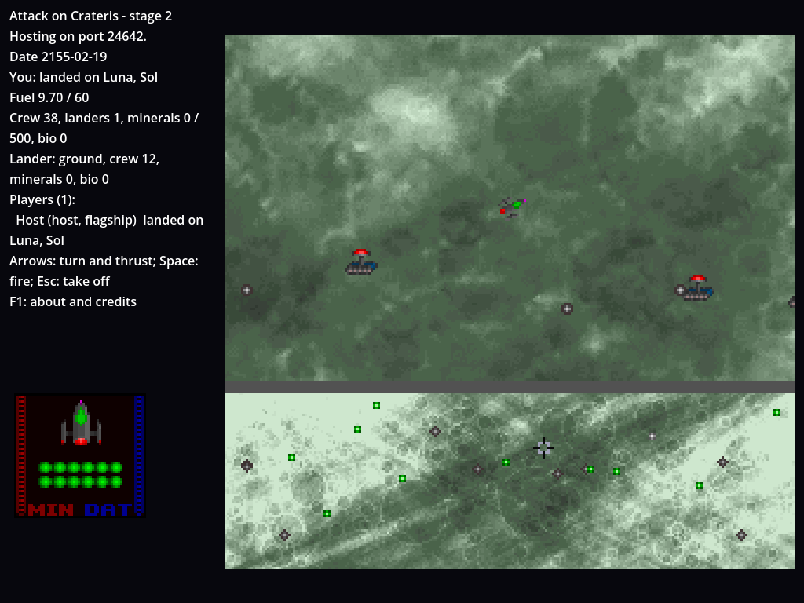
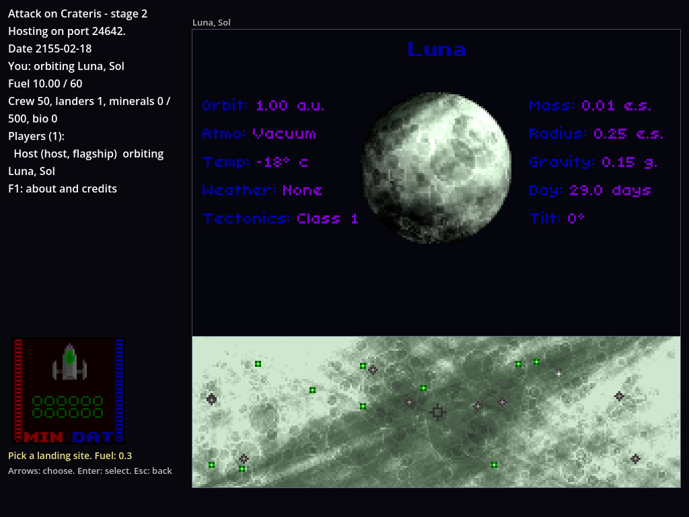
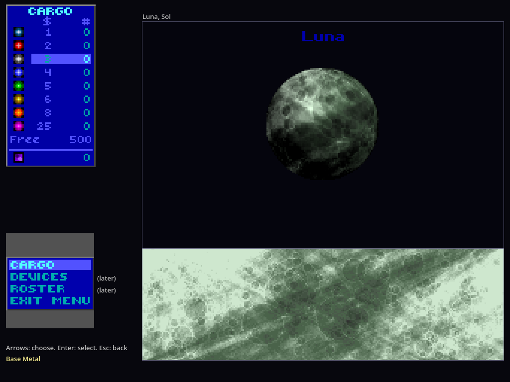

# How to try it: stage 2b, landing and mining

Stage 2b lands you on worlds. From orbit you pick a landing site, the lander drops onto the world's surface and you drive it around: pick up minerals until it's full, stun creatures until they're canned and pick them up as bio data, and survive quakes, lightning and lava, or lose crew to them, and the whole lander if they all die. Take off and what you carried is in your ship's hold, shown in the Manifest's Cargo display. Players orbiting the same world land on the same surface together, see each other, and race for the same deposits: each is taken once. Everything on the surface is UQM 0.8.0's own lander code, checked frame by frame against recordings of UQM. The plan, with every decision, is `docs/plans/stage-2b.md`; what differs from UQM is in `docs/differences.md`.



## Set up

As for the content stage (`docs/how-to-try/content-stage.md`):

```
dotnet build game/Crateris.Game.csproj
godot --headless --import --path game
```

## Run the tests

```
CRATERIS_CONTENT=~/Downloads/uqm-0.8.0-content.uqm python3 tools/run_tests.py   # every topic, several at a time
CRATERIS_CONTENT=~/Downloads/uqm-0.8.0-content.uqm python3 tools/test_network.py
```

What should happen: every topic passes and none is skipped (350 tests, about 40 s). `dotnet test` still runs them all too. `python3 tools/run_tests.py --list` shows the topics; `python3 tools/run_tests.py lander` runs one, and `--changed` runs only the topics that what changed since the last commit can affect (see "Tests by topic" below). Without the content package the tests that need it are skipped, each saying so. The network test prints `ok` lines ending in "all network checks passed"; it now also lands the host and a guest on Luna together.

## Play it: the whole stage in one go

1. **Orbit Luna.** `godot --path game -- --host --name Host --start-orbit 82:2:1`. Choose **Scan** and **Auto scan**: Luna's 9 deposits and 10 Brainbox Bulldozers appear on the scan map, in UQM's own dot images.
2. **Pick a site.** The cursor moves to **Dispatch lander**; choose it. The menu box gives way to the lander's gauges, powered down, and the status says what the landing costs ("Fuel: 0.3"). A flashing cursor sits mid-map: move it with the arrows (it wraps east and west and stops at the poles) and press Enter. Esc goes back to the scan menu.
3. **The landing.** The surface view replaces the planet: the lander waits a second above, then drops onto the planetside map with its shadow closing in. The gauges fill with 12 crew, one cell each; the ship's crew goes down by 12 and its fuel by the landing's cost.
4. **Drive.** Left and right turn, Up thrusts; Space, Enter or Ctrl fires stun bolts. The scan map below shows where you are (the cross) among the nodes, the creatures moving on it. Drive onto a deposit: it's picked up, its amount and element name flash up and drift with the ground, and the MIN bar grows. A full lander (50 units) leaves the rest where they are.
5. **Creatures.** Fire at a Brainbox Bulldozer: it's worth nothing, so a bolt destroys it. For creatures worth something try `--start-orbit 239:1` (Goo Burgers, Merry Whumpets, Whackin' Bushes) or `212:0` (Carousel Beasts: dangerous). Each hit stuns a creature and knocks it back, flashing; enough hits can it, and driving over the canister fills the DAT bar. Touching a live dangerous one can kill a crew member: its cell goes dark and the lander flashes.
6. **Hazards.** On shaky, stormy or hot worlds: `--start-orbit 293:1` (quakes), `212:0` (lightning), `393:1` (lava), `240:1` (all three, at their worst). Quakes and lava hurt 1 time in 4 each frame you touch them; a quarter of the lightning follows you and strikes. Lose all the crew and the lander blows up, and a couple of seconds later you're back in orbit without it.
7. **Take off.** Esc. The lander climbs off the screen, and you're back on the scan screen with what the scans had found. The status line shows the crew back aboard and the minerals and bio data in the hold.
8. **The cargo.** Leave the scan menu (Esc), choose **Manifest**, then **Cargo**: UQM's cargo display, each element category's icon, its worth and how much you hold, the bio data, and the room free. Up and down choose a category (its description shows below the menu); Enter drops a unit of it overboard. Esc goes back.
9. **With a friend.** `godot --path game -- --host --name Host --start-orbit 82:2:1 --guests-in-orbit` and `godot --path game -- --join 127.0.0.1 --name Guest --id guest-1`: the guest starts in orbit round Luna too (that's what `--guests-in-orbit` does; without it a guest undocks in the inner system and flies there). Both land: each sees the other's lander, shots and the creatures they chase, and a deposit both reach goes to whoever touched it first. Creatures go for the nearest lander; each lander has its own hazards round it. Quit the guest while landed: its lander takes off at once with its crew and cargo. Close the host while landed: the save keeps everyone in orbit with what their landers carried.

Compare with UQM 0.8.0 (PC menus) as you go: the surface, its sprites and their places, the gauges and the cargo display should match at three times UQM's size. What doesn't is in `docs/differences.md` (rows 30 to 35).





## The parts, and what checks them

Each part of the surface is UQM's own code, checked against recordings made by running UQM 0.8.0's `lander.c` with its drawing stubbed, `TFB_Random` seeded and the input scripted (`tools/extract/golden/lander.c`), replayed frame by frame with the same seed and input. Every frame's lander, element, random seed and hold must be UQM's.

| Part | Recording | Tests |
| --- | --- | --- |
| The ship's hold: crew, landers, storage bays, minerals by category, bio data; saved and sent | | `HoldTests` |
| Dispatching: the checks, the landing site picker, the fuel | every world (`landing.json`) | `LandingTests` |
| The planetside map (four times the scan map) | every landable world (`planetside-heights.json`, `planetside-colors.json`) | `PlanetsideMapTests` |
| Snapshots on the wire: binary deltas from what each guest has | | `SnapshotCodecTests` |
| The lander: landing, driving, turning, the poles and the wrap, firing, take-off | 12 landings, about 7,900 frames (`lander.json`) | `LanderTests` |
| Picking up deposits, partly when the lander is nearly full | 15 landings, about 17,300 frames (`lander-pickups.json`) | `LanderTests` |
| Creatures: placement, awareness, hunting and fleeing, stunning, canning, danger; the lander's death | 13 landings, about 8,100 frames (`lander-creatures.json`) | `LanderTests` |
| Hazards: chances for every world, quakes, lightning, lava, shields, the display queue's limit | 21 landings, about 10,100 frames, and every world's chances (`lander-hazards.json`) | `LanderTests`, `HazardTests` |
| The shared surface on the host: one per world, joining, taking off, leaving and saving while landed | | `SharedSurfaceTests`, `SurfaceSnapshotTests`, `LandingSessionTests`, the network test |
| The surface view, the gauges and the cargo display: every drawing call | 6 landings and 12 cargo displays (`lander-drawing.json`) | `PlanetsideScreenTests`, `CargoDisplayTests`, `CargoMenuTests` |

The co-op rules, which UQM with its one lander can't show, are checked by tests of our own: creatures go for the nearest lander that has crew (`LanderTests`), each lander has its own hazards and its lightning strikes only it (`HazardTests`, `SharedSurfaceTests`), a deposit two landers touch goes to one (`LanderTests`, `SharedSurfaceTests`).

The recordings can be made again from the UQM source (needs gcc, a checkout of UQM 0.8.0 and the content package):

```
python3 tools/extract/golden_uqm.py --uqm ../uqm-0.8.0/sc2 --content ~/Downloads/uqm-0.8.0-content.uqm
git diff --stat tests/golden   # should show no changes
```

The screenshots were taken under a virtual display:

```
xvfb-run -a -s "-screen 0 1024x768x24" godot --rendering-driver opengl3 --path game -- \
  --host --no-upnp --name Host --start-orbit 82:2:1 \
  --script "none:10,select:2,select:2,none:150,select:2,select:2,none:80,thrust:40,right:6,thrust+fire:30,none:5" \
  --quit-after 330 --screenshot landed.png
```

`--script` takes `fire` and `takeoff` now, as well as `left`, `right`, `thrust`, `action`, `none` and the menu keys.

## Tests by topic

Every test class belongs to one topic (`[Trait("Topic", ...)]`, the topics listed in `tests/topics.json`). `tools/run_tests.py` builds once and runs the topics you ask for:

```
python3 tools/run_tests.py --list            # the topics, and how many files each depends on
python3 tools/run_tests.py lander drawing    # just these
python3 tools/run_tests.py --changed         # the topics a change since HEAD can affect (or --since REF)
python3 tools/run_tests.py                   # every topic
python3 tools/run_tests.py --separate -j 3   # each topic in a test run of its own, three at a time
python3 tools/run_tests.py --map             # remake tests/topic-map.json (needs CRATERIS_CONTENT; about 7 minutes)
dotnet test --filter Topic=lander            # one topic with dotnet directly
```

By default the chosen topics run together in one test run, where xUnit runs their test classes in parallel on every core, and the results are reported topic by topic; the timing-sensitive tests run by themselves after the rest. That's the quickest way to run several topics: the data and content are loaded once. `--separate` runs each topic as its own test run, several at a time, heaviest first: each topic isolated, at the cost of loading everything again for each (on a 4-core machine about 47 s for every topic, against 37 s together).

`--changed` decides with `tests/topic-map.json`, which `--map` makes by running each topic under coverage (with `CRATERIS_CONTENT` set; it refuses to write a map if a test fails or is skipped, since that test may not have run all it would). For each topic the map holds the source files its tests ran, the files declaring the types its tests and that code name, the files declaring the enum values and constants that code uses (compiled in, so coverage doesn't see them), the test files whose helpers they use, and the recordings they name. A changed file runs the topics whose map holds it; a changed test file also runs the topics its classes are in now and were before, so a class moved to another topic runs there. A shared file (`tests/topics.json` "all": the UQM maths, the data, the test project, and the two files outside the code that tests read, `docs/design.md` and `game/project.godot`) runs every topic, and so does any file the map doesn't know (a new one, or one no test runs) outside `docs/`, `game/` and `tools/`, which run none. `TopicTests`, which checks every test class is in a known topic and the map covers every topic, always runs.

The map keeps a fingerprint of each file it was made from, and a file changed since then counts as changed too: an old map runs more topics than it needs to, never too few. `--map` (about 7 minutes) brings it back to the fewest; commit it with the change. Many core files (the orbit menu, the lander, the world, the system catalogue) reach most topics, so `--changed` saves most on the edges: the surface view runs only the drawing topic, a planet-map recording only the planet maps. It narrows the work while you go; the full run is what says the work is done.

Measured on a 4-core machine: every topic together 37 s (it was 56 s before the planet-map tests shared the world height maps they all start from); the lander alone about 8 s, the shared surface about 1 s. The planet maps (every world's maps) are the long one. Under `--map` their every-world loops take 24 worlds spread over the list (`Golden.Sample`), which reach the same code, and the codec's timing test only runs its code: coverage slows everything down.

## Known limits of stage 2b

- **No energy nodes on the surface:** they show on scans, but only story worlds have them and picking them up is a story event (stage 3, decision 4).
- **Nothing to spend it on:** minerals and bio data can't be sold, and lander upgrades and shields can't be had, until the starbase and the Melnorme (stage 3). The rules for upgrades and shields are in and tested.
- **No boarding or launch animations:** UQM shows the crew boarding and the lander launching before the landing, and the lander coming back after it. They take no time here, so the gauges show the crew aboard at once (`docs/differences.md` row 35).
- **No sound,** as in every stage so far.
- **The scan map's dots at its very edges** can spill a few pixels past it; with many players the status lines can reach the gauges.

## Bugs

Send the error text, a screenshot and what you expected. The terminals print what happened, including "Landed", the other landers seen, crew deaths and "Back in orbit" with what came back. Add `--report FILE` to get it as JSON.
