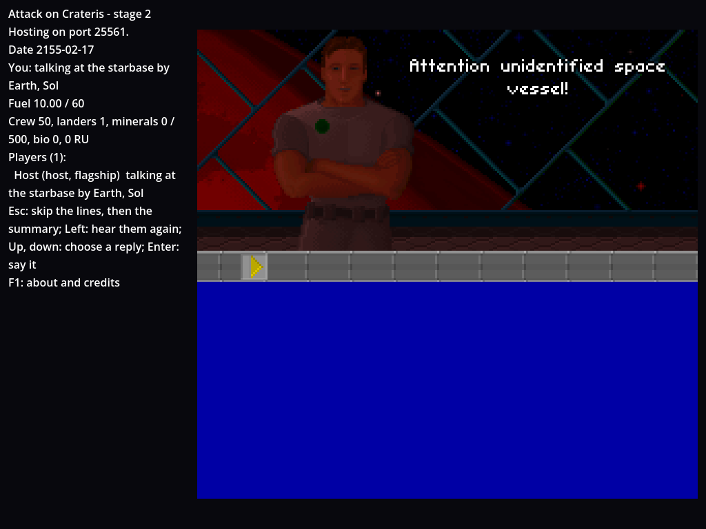
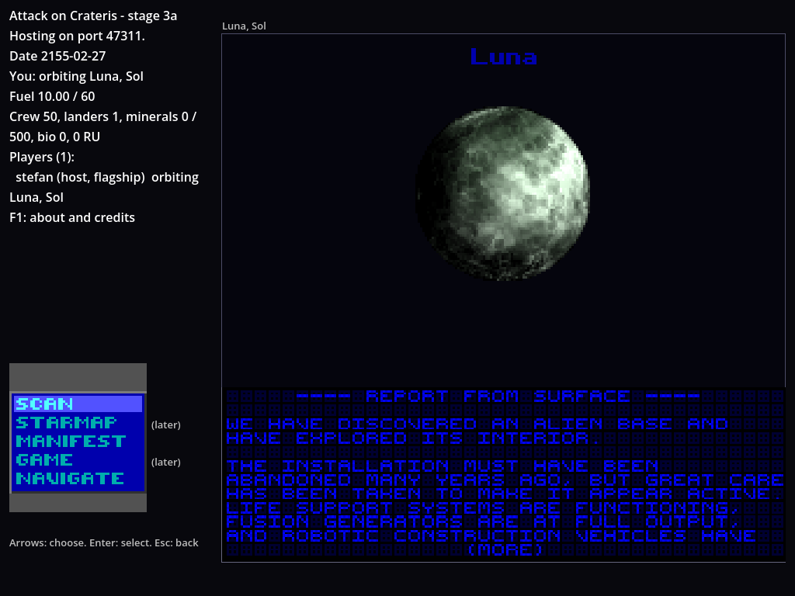
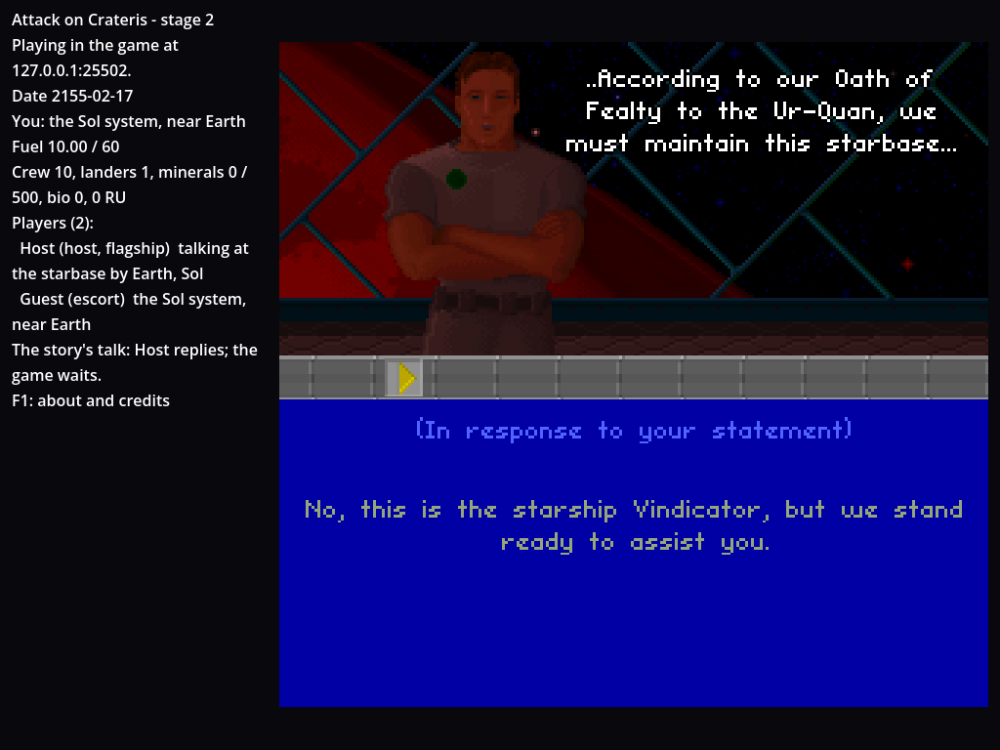
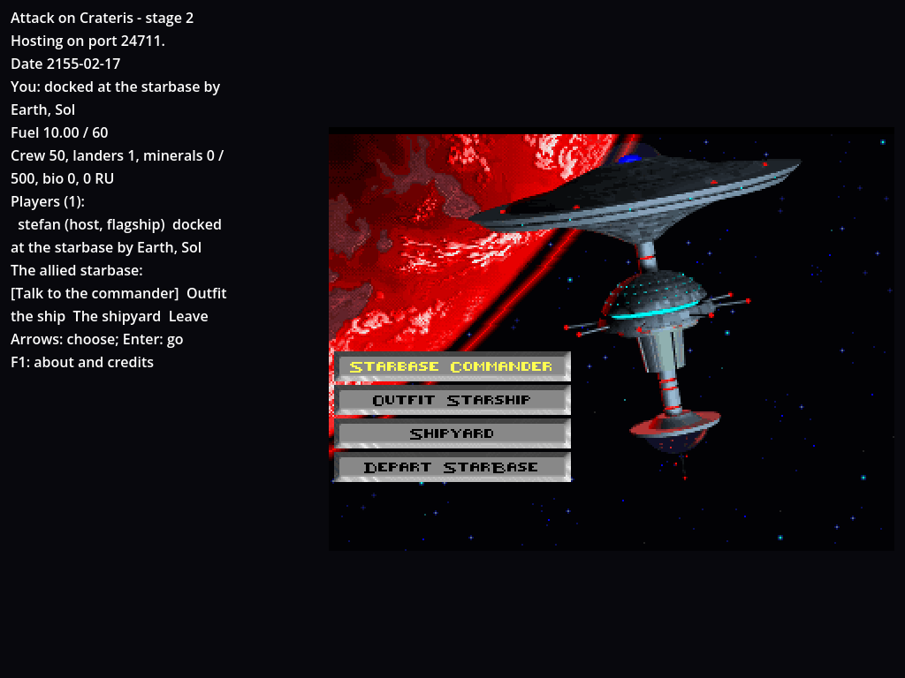
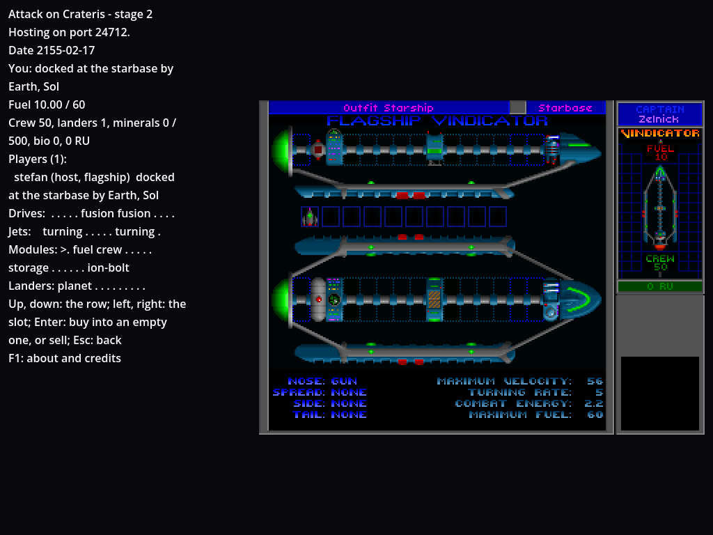
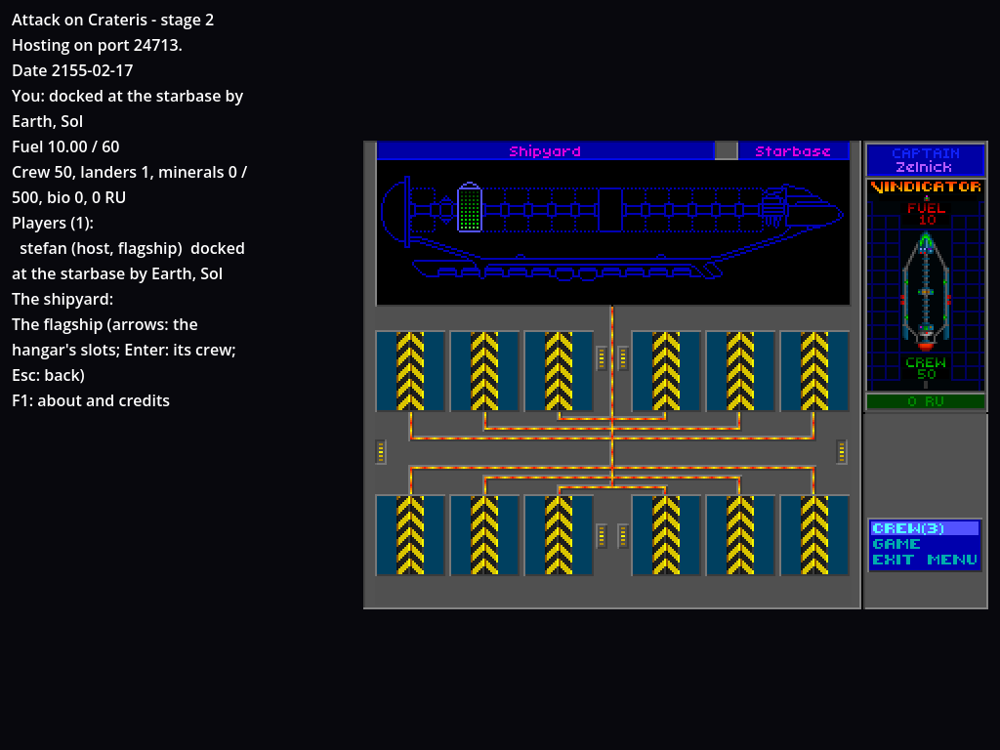
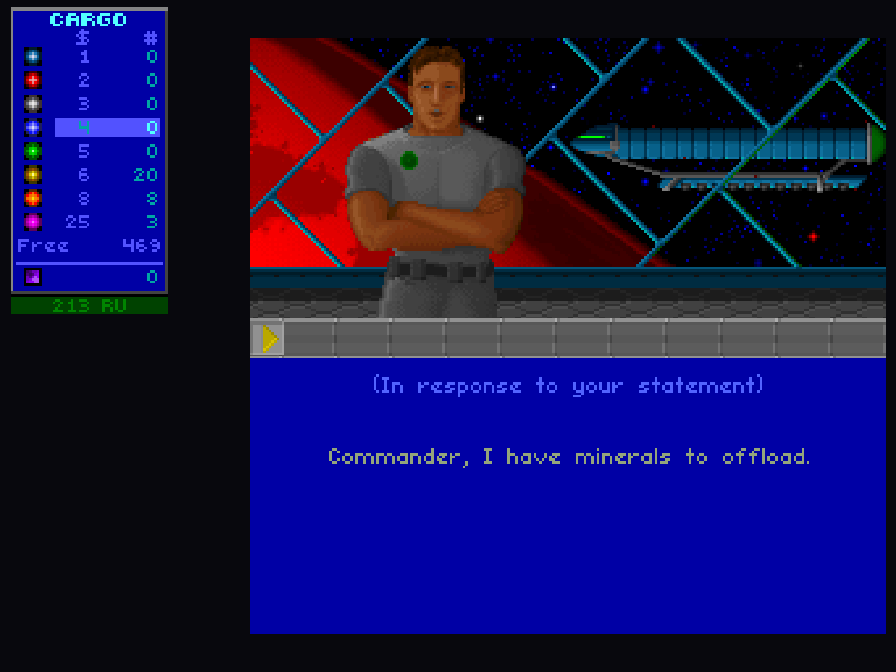
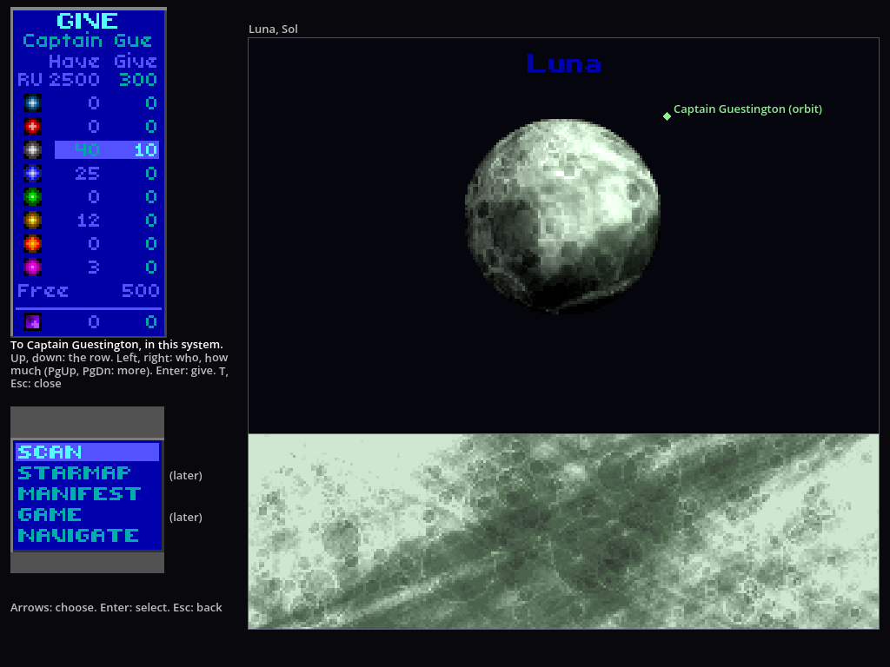
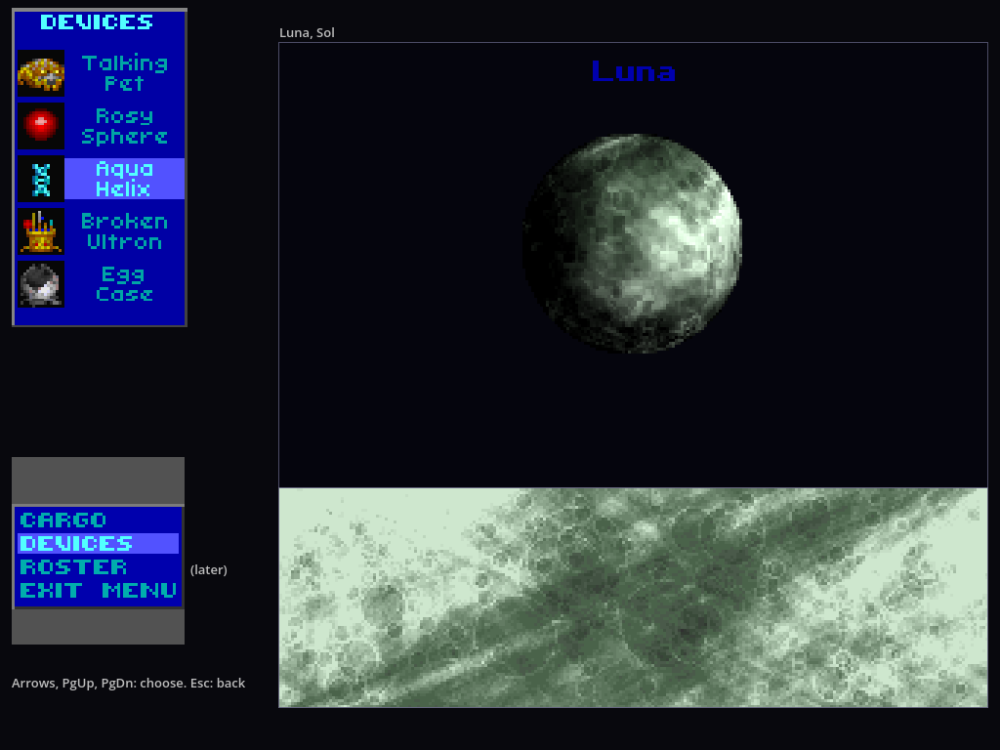

# How to try it: stage 3a, talking, the story state and Earth

Stage 3a plays UQM's opening together. Fly to Earth and Starbase Commander Hayes hails you on UQM's communication screen, animated as UQM animates him, his lines paged at UQM's pace. Every player sees the talk while the game waits (a story pause); the player who flew in picks the replies. Fetch radioactives from Mercury and the Lunar base from Luna, tell him, and the opening runs as in UQM: an Ilwrath ship hails and attacks, the commander makes the alliance and you name it, two weeks pass for everyone, and the starbase opens with 2,500 resource units for the group. From then on each player docks at the starbase on their own: talks to the commander (one player at a time), sells minerals, buys fuel, crew, landers and modules from their own wallet, and renames their ship and captain. Players can give each other resource units anywhere, and minerals and bio data within one system. The group's devices are listed in the Manifest. The scripts are UQM 0.8.0's own, ported line for line and checked against recordings of UQM running them; so are the screens. The plan, with every decision, is `docs/plans/stage-3.md`; what differs from UQM is in `docs/differences.md`.



## Set up

As for the content stage (`docs/how-to-try/content-stage.md`):

```
dotnet build game/Crateris.Game.csproj
godot --headless --import --path game
```

## Run the tests

```
CRATERIS_CONTENT=~/Downloads/uqm-0.8.0-content.uqm python3 tools/run_tests.py   # every topic
CRATERIS_CONTENT=~/Downloads/uqm-0.8.0-content.uqm python3 tools/test_network.py
python3 -m unittest discover -s tools/extract                                   # data checks
```

What should happen: every topic passes and none is skipped (1,133 tests in 14 topics, about 25 s together). Stage 3a added the topics `story`, `talk`, `opening`, `starbase` and `trading`; `python3 tools/run_tests.py --list` shows them all, and "Tests by topic" in `docs/how-to-try/stage-2b.md` says how to run some of them. The network test prints `ok` lines ending in "all network checks passed"; its last part starts the host in the commander's talk and has a guest join and watch it, the host's reply bringing the next set of replies. The data checks say `OK (skipped=3)`: the three skipped need the UQM source (`docs/uqm-data.md`).

## A host and a guest

Start a host on a new game and a guest that joins it (on one machine, or the guest on another with the host's address):

```
godot --path game -- --host --name Host --save /tmp/opening.json
godot --path game -- --join 127.0.0.1 --name Guest --id guest-1
```

`--save FILE` keeps this game in its own file, so the host starts a new game rather than loading its saved one (without it the host loads `host-save.json` in Godot's user folder, `~/.local/share/godot/app_userdata/Attack on Crateris/` on Linux, if there is one). The host starts in hyperspace on Sol. The guest's escort undocks beside the host's ship. The host's ship is the flagship *Vindicator* with Captain *Zelnick*, UQM's names; a guest's captain is the name they joined with and their ship is named by a host setting ("Wayfarer" for now). A talk speaks the names of whoever started it.

Keys, as in stage 2 and 2b: arrows fly (left and right turn, up thrusts); in menus the arrows choose, Enter or Space selects, Esc or Backspace goes back. New in 3a: on the communication screen, Up and Down choose a reply and Enter says it; Esc skips the lines being said, and with the replies up Esc opens the summary of the talk so far (Enter, Esc or Right turns its pages and closes it after the last); Left plays the lines again. T opens the giving screen; F2 and F3 rename the ship and the captain while outfitting. F1 is the about screen, as before.

## Play it: the opening at Earth

1. **The commander hails.** Fly onto Sol, in to Earth (the third planet), and into the starbase beside it in Earth's inner system. The communication screen opens: the commander, animated, his words paged a line at a time, 80 milliseconds a character. When he's done the replies show below; your ship's and captain's names are in them. The guest's screen shows the same talk at once: their status says "The story's talk: Host replies; the game waits.", their keys do nothing, and their screen follows the host's (lines skipped, played again, the summary). The date stops while it goes on, and so does every ship, every lander on a surface and every orbit menu. Try to land or press T meanwhile: "The game waits while the story's talk goes on."
2. **Who replies.** Whoever flew in replies. If the guest flies into the starbase first, the guest replies and the host watches. If the replier quits, the replies pass to the next player in join order, the host first, and the talk stays the starter's (their names, their ship). A player who joins during a talk watches it.
3. **Mercury.** The commander asks for radioactives. Fly out to Mercury (the first planet) and into orbit; Scan, Auto scan: two of its deposits are uranium, a radioactive. Dispatch the lander, drive onto them, take off (Esc). Back at Earth's starbase the talk goes on. As in UQM he doesn't take them out of the hold. If you've run short of fuel, or have no lander, he gives you fuel or a lander with crew, as UQM's commander does.
4. **The Lunar base.** He warns of the base on Luna (Earth's second moon). Orbit Luna and scan: the energy scan shows the base as Luna's one energy node. Land and drive onto it. The lander report is typed into the scan map's area, a letter at a time, in UQM's lander font; a key while it types shows the rest of the page at once, and at the end of a page it waits for a key. The lander takes off by itself with its crew. The base is aboard: the Manifest's Devices list shows "Moon Base". Any other player's lander on Luna stays down, and they get a notice saying who found the base, with the report's text a page at a time.

   

5. **The alliance.** Fly back into Earth's starbase. Report the base dealt with, and the opening runs at once, every player watching:
   - the commander warns of the Ilwrath, and an Ilwrath ship hails: its replies all lead to the battle, which counts as won (there's no combat before stage 4);
   - the commander again: "What a beautiful sight", the alliance, and you name it from four choices, one of them using your captain's name;
   - the screen fades to black over two seconds and two weeks pass: the date jumps 14 days for everyone;
   - the commander says the starbase is ready and gives 2,500 resource units, split equally between the players in the game (the starter keeps what doesn't divide: 1,250 each with two players);
   - the starbase's menu opens for the player who flew in.

UQM's own scripts decide every line and reply: what he says depends on what you bring and how often you've been. A save made during one of these visits is of the game before it, as UQM can't save in a talk.



## The allied starbase, with a friend

Once the starbase is open, each player docks by flying into it. Talking to the commander from its menu is an ordinary talk, not a story pause: the others play on, and the clock runs.

1. **The menu.** Each docked player has the starbase's menu, drawn as UQM draws it with the station turning and its power lines cycling: Starbase Commander, Outfit Starship, Shipyard, Depart Starbase. The status panel lists them in words ("Talk to the commander", "Outfit the ship", "The shipyard", "Leave") with the keys.
2. **The commander, one at a time.** One player chooses Starbase Commander: their own talk, which only they see. He greets a player once each visit. If the other player chooses it meanwhile, they're told "The commander is talking with Host." and the rest of their menu works.
3. **Selling minerals.** With minerals aboard, the talk offers "Commander, I have minerals to offload." Say it: the cargo display appears left of the communication screen and counts the hold down a unit at a time, a category at a time, the resource units below it rising. Any key but F1 sells the rest at once. Then the commander's reply plays. Only the seller sees the count; the units go into the seller's wallet only.
4. **Outfitting.** Outfit Starship shows the flagship's slots as UQM's screen does, with the menu Fuel, Modules, Save game, Exit. Fuel: up and down buy or sell a unit, Page Up and Page Down a whole bar, Enter done. Modules: the arrows move over the drive, jet, module and lander rows; Enter on an empty slot chooses a module with left and right and Enter buys it, Enter on a filled one sells it, Esc goes back. Landers go up to 10. Prices come from the story: fuel is 20 resource units a unit at the start. An escort buys fuel and crew within its kit, landers, and storage bays; its other modules wait for the escort module set (still open in `docs/design.md`).
5. **Renaming.** While outfitting, F2 renames the ship and F3 the captain: a line to type in, Enter keeps the name, Esc leaves it. The talks use the new names.
6. **The shipyard's crew.** Shipyard: Crew, Save game, Exit. Crew puts the cursor on your ship among the hangar's twelve slots; Enter on it, then up hires a crew member and down sends one away, at the crew price (3 resource units at the start; the group's purchases raise it as UQM's do), Enter is done. An empty slot can't be chosen: fleet ships come with combat.
7. **Save game** is the host's alone (a guest's is refused): it saves at once, and the status says "Game saved."
8. **Depart Starbase** puts you back in flight beside it.

Each player's wallet, fuel, crew and landers change only for them. What another player changes meanwhile (a gift's units, the crew price they've moved) is drawn on your screen as it comes.









## Giving: T

T opens the giving screen (T, Esc or Backspace closes it), in the status area over whichever screen you're on, while another player is in the game. Its rows: the player you give to (left and right choose), your resource units, the eight mineral categories and the bio data, each with what you have and how much to give. Up and down choose a row, left and right change the amount by one (or the player), Page Up and Page Down by more; Enter gives that row's amount. Resource units go to a player anywhere; minerals and bio data only to a player in the same solar system, minerals only up to their free storage (less what their lander that is down may still bring up). With the receiver elsewhere the cargo rows are dimmed. Both players get a notice ("You gave Guest 200 RU."); a refusal says why ("Their storage bays haven't the room.", "Cargo goes only to a player in the same system."). It doesn't open during a talk or a story pause, nor over the Manifest's cargo display or Devices list.



## The Manifest's Devices list

In orbit, Manifest, then Devices: the group's devices as UQM's `devices.c` lists and draws them, each with its icon and its name a word a line, five rows at a time. Up and left go back, down and right on, Page Up and Page Down a screen at a time; Enter says "Using devices comes in a later stage (3c)."; Esc goes back. With nothing aboard it doesn't open. The devices are story fields, so every player's list shows the group's, and follows while it's open.



## Save and load

The host saves every minute and as it quits, to `host-save.json` in Godot's user folder or the `--save` file; Save game at the starbase saves at once. Start the host again (`godot --path game -- --host`, or `--load FILE`) to load it. The story state comes back (the alliance, the starbase, what the commander knows, the devices), and each player's wallet, cargo, names and ship's slots. A save made while docked loads with the ship in flight by the starbase: fly into it again to dock. A save made during the opening's visit is of the game before that visit began.

## Shortcuts for testing

Each of these starts a host where a step can be tried at once (the host's options; a guest joins as above):

| Option | What it does |
| --- | --- |
| `--start-visit` | A new game starts in the commander's first talk at Earth's starbase |
| `--start-docked` | A new game starts docked at the starbase's menu, the opening over: the starbase ready, the commander met, no news |
| `--start-minerals N,N,N,N,N,N,N,N` | The host's hold starts with these minerals, by category: common, corrosive, base metal, noble, rare earth, precious, radioactive, exotic |
| `--start-units N` | The host's wallet starts with N resource units |
| `--start-devices DEVICE[,DEVICE]` | The group carries these devices, by `data/devices.json`'s name (`LUNAR_BASE_DEVICE`) or number |
| `--start-orbit STAR:PLANET[:MOON]` | A new game starts in orbit there: Sol is star 82, so Mercury is `82:0` and Luna `82:2:1` |
| `--start-at X:Y` | The host starts in hyperspace there, in universe units (Sol is at 1752:1450) |
| `--guests-in-orbit` | Guests joining for the first time start in orbit where the host is |
| `--show-report RESOURCE` | Shows a lander report as if your lander had found it (`text.moonbase` is the Lunar base's): on the screen with `--start-orbit`, else as a notice |
| `--script "STEP,STEP"` | Scripted input instead of keys, each step `name:frames`. `left`, `right`, `thrust`, `action`, `fire`, `takeoff` and `none` are held; `up`, `down`, `select`, `cancel`, `pageup` and `pagedown` press a menu key once as their step starts (in a talk they choose and say replies, docked they're the starbase's keys); `give` opens or closes the giving screen |
| `--quit-after FRAMES`, `--screenshot FILE.png`, `--report FILE` | Quit after so many frames, saving a screenshot (needs a display) and what happened as JSON |

What should happen with each (each was run this way):

- `--start-visit`, and a guest joining: the host's screen has the commander's talk with the replies; the guest's has the same talk and "The story's talk: Host replies; the game waits." With `--script "none:200,select:1,none:400"` the host says the first reply, "No, this is the starship Vindicator, but we stand ready to assist you.", and both screens show it.
- `--start-docked --start-minerals 0,0,0,0,0,20,8,3 --script "none:12,select:1,none:12,select:1,none:2000"`: Starbase Commander, then the first reply, the minerals one. The hold counts down and the wallet ends at 259 resource units (20 precious at 6, 8 radioactive at 8, 3 exotic at 25).
- `--start-docked --start-units 1000 --script "none:12,down:1,none:6,select:1,none:12,select:1,none:6,up:1,none:3,up:1,none:6,select:1,none:30"`: Outfit Starship, Fuel, two units more. Fuel 12, 960 resource units.
- `--start-docked --script "none:12,down:1,none:3,down:1,none:6,select:1,none:12,select:1,none:12,select:1,none:12,down:1,none:3,down:1,none:30"`: Shipyard, Crew, the ship's crew, two sent away. Crew 48, 6 resource units.
- `--start-docked --script "none:30,select:1,none:2000"` on the host, and a guest with `--script "none:80,left:8,thrust:4,none:340,select:1,none:200"`, which flies the escort from where it undocks into the starbase and chooses Starbase Commander: the guest docks with its own menu, and is told "The commander is talking with Host."
- `--start-orbit 82:2:1 --guests-in-orbit --start-units 2500 --script "none:200,give:1,none:5,pageup:1,none:3,pageup:1,none:3,select:1,none:150"` with a guest: the giving screen opens on the resource units, two Page Ups make 200, Enter gives them. The host has 2,300, the guest 200.
- `--start-orbit 82:2:1 --start-devices LUNAR_BASE_DEVICE,ROSY_SPHERE_DEVICE --script "none:10,down:1,none:3,down:1,none:3,select:1,none:5,down:1,none:3,select:1,none:100"`: Manifest, Devices: the Rosy Sphere and the Moon Base.
- `--start-orbit 82:2:1 --show-report text.moonbase`: the Lunar base's report typed over Luna's scan map.
- `--start-orbit 82:0 --script "none:10,select:1,none:5,select:1,none:350"`: Mercury auto-scanned, 19 mineral deposits.
- Save and load: quit a `--start-docked` game after selling (`--quit-after 900 --save FILE`), then `--host --load FILE`: the ship is in flight by the starbase with its 259 resource units, and the story has the starbase available.

## The parts, and what checks them

As in 2b, UQM's own code is recorded and the port must do the same: the scripts run in a recording program with UQM's `commglue.c` and the rest of the engine stubbed, every reply walked from starting states chosen to reach every condition each script reads (`docs/uqm-data.md`).

| Part | Recording | Tests |
| --- | --- | --- |
| The story state: UQM's 447 fields, the prices, the element worths, the races' standing, the clock's events; saves and snapshots | | `StoryStateTests` |
| Captain and ship names | | `ShipNamesTests` |
| The conversations' lines, descriptions and frames as UQM loads them | `conversation-cases.json`, `conversations.json`, `comm-graphics.json` | `ConversationContentTests` |
| The talk engine and the commander's, the Ilwrath's and the allied commander's scripts | every path: the commander's from 174 starting states, the Ilwrath's, the allied commander's from 260 (`talks.json`) | `TalkTests` |
| The opening's sequence, the Lunar base, story pauses and who replies | | `OpeningTests`, the network test |
| The dialogue lock | | `DialogueLockTests` |
| The allied starbase: docking, the menu, outfitting, the shipyard's crew, renaming | 129 outfitting scenarios (`outfit.json`) | `StarbaseTests`, `OutfitTests` |
| Wallets and giving | | `TradingTests` |
| The group's devices and the Devices list | 43 scenarios (`devices.json`) | `DevicesTests`, `DevicesDisplayTests`, `OrbitMenuTests` |
| The communication screen: animations, colour fades, text, paging | `commanim.json`, `cmap.json`, `commtext.json` | `AlienAnimationTests`, `ColorFadesTests`, `CommTextTests`, `CommScreenTests` |
| The starbase's screens drawn call for call | `screens.json` | `StarbaseScreensTests` |
| The lander report and the minerals' count-down | `report.json`, `selling.json` | `DiscoveryReportTests`, `MineralSellingTests` |
| The giving screen (our own, laid out after the cargo display) | | `GivingScreenTests` |

The co-op rules UQM can't show are checked by tests of our own: story pauses and the replies passing on (`OpeningTests`), the gift split (`OpeningTests`), a second player at the commander (`StarbaseTests`, `DialogueLockTests`), gifts between players (`TradingTests`).

The recordings can be made again from the UQM source, as for 2b (`docs/how-to-try/stage-2b.md`): `python3 tools/extract/golden_uqm.py --uqm ../uqm-0.8.0/sc2 --content ~/Downloads/uqm-0.8.0-content.uqm`, then `git diff --stat tests/golden` shows no changes.

## What's different from UQM

Each is a row of `docs/differences.md`:

- The clock runs at one rate in every activity, talks and the starbase too; only story pauses stop it (rows 1 and 2).
- The story's talks and the two weeks passing are shown to every player while the game waits; whoever started replies (rows 2, 3 and 42).
- The Ilwrath's battle counts as won until combat comes in stage 4 (row 39).
- The Ur-Quan drone isn't at Earth until ships in space come in stage 3b, so the commander can't be asked about "the red thing" (row 40).
- The starbase's 2,500 resource units are split between the players (row 37); each player has their own wallet and can give units and cargo (rows 11 and 22).
- The Lunar base with several landers on Luna (row 38); the devices are the group's (row 10).
- One player talks to the commander at a time; several players dock at once, each with their own screens; only the host saves (rows 17 and 46).
- Of UQM's status area only the cargo display, the minerals' count-down, the giving screen and the Devices list are drawn; the status panel's text stands for the rest (row 45). The shipyard crews each player's own ship only, and the Arilou's gift of ships waits for fleets (rows 43 and 44).
- Touching the other starbases and homeworlds still does nothing until stage 3b (row 27).
- A talk's fields that aren't story (where it is, how it ends, the greeting) are the talk's or the player's own (row 36).

## Known limits of stage 3a

- **No sound:** no music, voices or the report's typing sound, as in every stage so far. The lines are paged at UQM's pace without voices.
- **No combat:** the Ilwrath fight, buying fleet ships and the Arilou's gift wait for stage 4.
- **No other races:** every other conversation, the drone, the Slylandro probes and the Melnorme come with ships in space in stage 3b (which comes after stage 4).
- **No story events:** the event calendar keeps its dates and is saved, but no event runs until stage 3c, nor do the devices do anything, the other energy nodes' stories (Fwiffo on Pluto among them) or the other time skips.
- **The status panel** still stands for most of UQM's status area (the flagship's picture, crew, fuel, names, landers), and still says "stage 2" at the top.

## Bugs

Send the error text, a screenshot and what you expected. The terminals print what happened, including each reply chosen ("Reply 0: ..."), the starbase keys, gifts and lander reports. Add `--report FILE` to get it as JSON, with the talk last shown and whether the game waited for a story talk.
