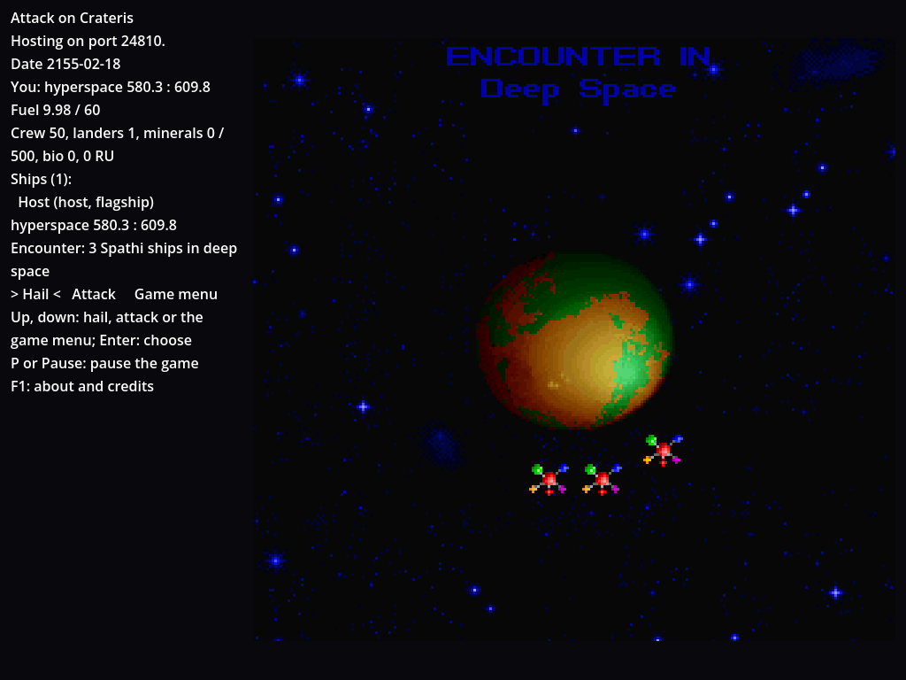
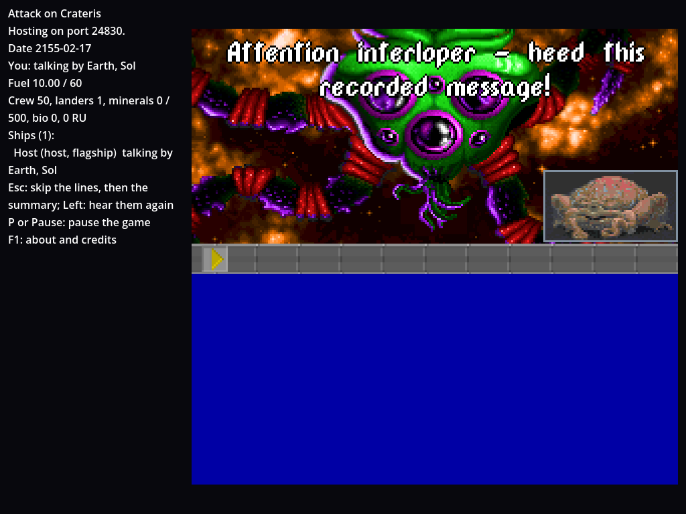
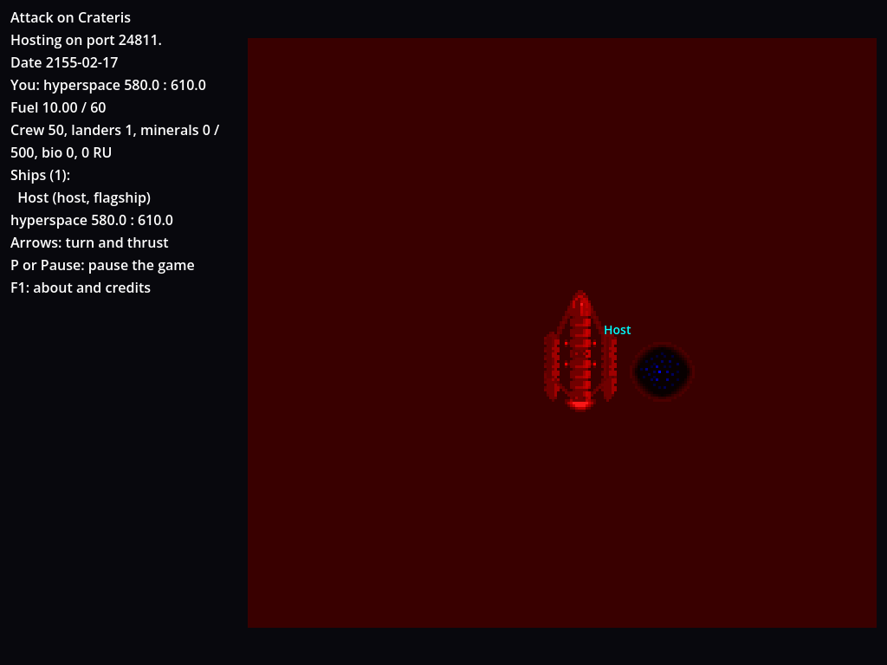

# How to try it: stage 3b-1, ships in space with five races

Stage 3b-1 brings alien ships into space. Groups of ships appear in hyperspace day by day, inside each race's sphere, and in star systems as UQM draws them, and fly at the nearest player. Touching one meets it as UQM's flagship does: the spin into it, the encounter screen (Hail or Attack), the race's talk on the communication screen, a battle if the talk ends hostile or the player attacks, and the battle-won screen's tally. Five races' talks are ported, each checked path for path against UQM's own: the Ur-Quan (and their drone at Earth), the Kohr-Ah, the Ilwrath, the Spathi and the Slylandro probes. Only their groups fly; the other races' come with stage 3b-2. With several players, the player a group touches meets it alone, under the race's dialogue lock; the others fly on and are told what happened. The plan, with every decision and the owner's answers, is `docs/plans/stage-3b.md`; what differs from UQM is in `docs/differences.md`.



## Set up

As for the content stage (`docs/how-to-try/content-stage.md`):

```
dotnet build game/Crateris.Game.csproj
godot --headless --import --path game
```

The commands below are written `godot --path game -- ...`; use the Godot 4 .NET (mono) build. Add `--content FILE` if the game hasn't downloaded the content itself. Give a testing host a `--save` file of its own, so it doesn't write over `host-save.json`.

## Run the tests

```
CRATERIS_CONTENT=~/Downloads/uqm-0.8.0-content.uqm python3 tools/run_tests.py   # every topic
CRATERIS_CONTENT=~/Downloads/uqm-0.8.0-content.uqm python3 tools/test_network.py
python3 -m unittest discover -s tools/extract                                   # data checks
```

What should happen: every topic passes and none is skipped (2,384 tests in 16 topics). Stage 3b-1's tests are in the topics `world` (the meetings, the wire, the notices: `MeetingTests`, `UrquanMeetingTests`, `IlwrathSpathiMeetingTests`, `SlylandroMeetingTests`, `MeetingWireTests`, `NoticeTests`), `hyperspace` (`HyperEncounterTests`), `systems` (`SystemGroupTests`), `story` (`ClockEventsTests`, `RaceFleetsTests`), `talk` (each script's recorded paths) and `drawing` (`EncounterScreenTests`, `GroupDrawingTests`). The network test prints `ok` lines ending in "all network checks passed". The data checks say `OK (skipped=3)`: the three skipped need the UQM source (`docs/uqm-data.md`).

## Keys

Flying, as before: the arrows turn and thrust. At the encounter screen, up and down move between Hail and Attack (and, for the host, Game menu), Enter chooses; the status lines show the cursor ("> Hail <   Attack     Game menu"). The game menu isn't built: choosing it says "Game menu comes in a later stage." and leaves the screen up (a guest has Hail and Attack only). In a talk, as in stage 3a: Esc skips the alien's lines and then shows the summary, Left plays them again, up and down choose a reply, Enter says it. On the battle-won screen any key held hurries its fades, and Esc pressed afresh ends it.

## Play it: the drone at Earth

Start a new game (`godot --path game -- --host --save /tmp/drone.json`), leave the starbase and fly about Earth's inner system: the Ur-Quan drone orbits Earth and comes for the ship. Touching it, there's no encounter screen (its talk isn't hostile): the communication screen plays its whole message. Once it has played, the meeting waits three seconds more (UQM's last replay; Left hears it again, Esc shows the summary), then the drone flies off out of Sol and the ship flies again. At the starbase the commander's talk offers "what was that red thing?", as UQM's does (stage 3a's talk).



A quicker way there, tried headless: `--start-orbit 82:2 --script "none:30,up:1,none:3,select:1,none:1500"` puts the host in orbit about Earth and chooses Navigate: the drone meets the ship within a few frames of leaving orbit, and the log shows "Leaving orbit", "host talks to the Ur-Quan" with the message, "The talk with the Ur-Quan ends: peace", "host hears the Ur-Quan's closing lines", "host: the closing lines heard" and "host's meeting with the Ur-Quan is over".

## A group of your choosing: `--start-encounter SHIP[:SHIPS]`

```
godot --path game -- --host --id host --name Host --start-at 5800:6100 --start-encounter spathi:3 --save /tmp/meet.json
godot --path game -- --join 127.0.0.1 --name Guest --id guest-1
```

A group of that ship's race (`data/ships.json`'s id, as `--start-battle`'s: `urquan`, `blackurq`, `ilwrath`, `spathi`, `slylandr`; every other race's since stage 3b-2 item 11, whose talks its items port: `docs/how-to-try/stage-3b-2.md`; the Syreen and the humans, who have no talk in space, are refused) of SHIPS ships (the race's fewest in a group without) appears by the host and flies at it: in hyperspace with `--start-at`, else in Sol's inner system after the opening, by Earth (an Ur-Quan group there is among Sol's own and gives the drone's message, as UQM's talk reads it).



1. **The group.** In hyperspace it comes in through its vortex as a black globe and flies at the nearest player; in a system it's drawn as its race's ship's icon, at the viewer's zoom, and flies at the nearest player in its view.
2. **The meeting.** Touching it (in hyperspace the ship spins into it first), the encounter screen: "ENCOUNTER IN DEEP SPACE" (or "ENCOUNTER AT" the cluster and the world named), the battle's planet in the middle and the group's ships round it. Hail: the race's talk on the communication screen. The Spathi can be left in peace ("We leave as we came, in peace.") or fought; the Ur-Quan and the Kohr-Ah are hostile (the Ur-Quan take a surrender: the game over for the host's flagship, a wreck for a guest's ship); the Ilwrath fight after their news; a probe threatened fights, and the destruct code (once aboard) destroys the probes at once. Attack, or a talk ending hostile: the battle against the group's ships, one at a time, with their crews.
3. **The closing lines.** The alien's last lines after the last reply play on the communication screen; the meeting waits there for that player (three seconds once they've played) before its battle or the flight on. Everyone else plays on meanwhile.
4. **After it.** In hyperspace a group talked to is gone (one-shot) and a group fought is gone, or re-forms with the crew it had left if everyone retreated; in a system a group talked to stands down and stays, one fought turns its race's groups on the players.
5. **The battle-won screen.** A battle won (or the probes' instant victory) shows UQM's tally in the space window: the ships destroyed flashing in, each one's bounty added up, then the player's share as the debris scavenged. The ship waits while it plays (about nine seconds for one ship); a key held hurries it, Esc pressed afresh skips it.
6. **A friend.** A guest flying into the battle's marker joins the battle, and has a share of the salvage if it's in it when it's won. While a player meets a group, a group of the same race touching another player passes through them, and they're told who's talking ("Host is talking to the Spathi.").

`--encounter-choice hail|attack` makes the host's choice at the screen as it comes up, and `--meeting-replies I,I,...` the host's replies, by their place among those offered from 0, one each set in turn: for headless runs, which have no keys.

## Groups by themselves

- **The probes.** In a new game, before the alliance, a Slylandro probe comes in hyperspace, one at a time. Tried headless: `--start-at 5800:6100 --seconds-per-day 1 --quit-after 3000` met "a group of 1 Slylandro ship" within the run.
- **The spheres.** Inside a race's sphere groups appear day by day and give chase. A sphere's centre is its ship's `fleet` home in `data/ships.json` and its radius strength × 11 / 2 universe units (`SPHERE_RADIUS_INCREMENT`, `check_hyperspace_encounter`): the Spathi's is 2549:3600 with a radius of 990; the Ur-Quan's 5750:6000, 2662. Tried headless (a new game, the default day): `--start-at 2549:3600 --quit-after 3000` met "a group of 4 Spathi ships"; at 5800:6100, inside the Ur-Quan's sphere and the Kohr-Ah's (6000:6250, 2662), a group of four Ur-Quan came of its own after the `--start-encounter` Spathi had gone (the run below). Before the alliance a probe comes too, from day one, and may come first (at 5800:6100 with `--seconds-per-day 1`, and at the Ilwrath's 48:1700, a probe met the host first): talk to it, fight it or flee it, and the sphere's own groups come after. With two players far apart in hyperspace each meets groups as they would alone.
- **Systems.** In a system inside a sphere, groups orbit the worlds and turn on a player who comes near, as UQM's turn on the flagship. A system's groups are kept for the players who were there.
- **Worlds.** Orbiting the Ilwrath homeworld (`--start-orbit 220:0`) starts the Ilwrath's talk against their endless fleet: the log shows "host at the encounter screen: an infinite fleet of Ilwrath ships" and the status lines "Encounter: an endless fleet of Ilwrath ships at Planet I, Alpha Tauri". Spathiwa's moon was orbited as any world until the Spathi at home (`spahome.c`) came with stage 3b-2 item 2 (the owner kept it so till then, question 5): `docs/how-to-try/stage-3b-2.md`.
- **A friend in the same system.** When another player meets a group, its race's ships stand down toward everyone there; when that meeting ends in peace or a battle, everyone is told, as they are of a battle starting and the race turning on them (in words in the status area: notices are told to every player).

## Save and load

The host saves every minute and as it quits. The groups are saved: hyperspace's encounters with their ships and crews, and each system's groups as they were. A meeting isn't saved: a save during one is of the game with the ship where it met the group and the group as before it, the talk's story writes kept; but a save made while a player's meeting waits at its closing lines carries the talk's end, as leaving then does (the owner, question 13): after a peace the group written back, the drone sent off, a surrender or an instant victory gone through, no battle. Tried: `--start-at 5800:6100 --start-encounter spathi:2 --quit-after 10 --save /tmp/g.json`, then `--load /tmp/g.json --save /tmp/g.json`: the save has the Spathi group with its two ships of 30 crew, and the loaded game meets it ("host meets a group of 2 Spathi ships").

## Shortcuts for testing

| Option | What it does |
| --- | --- |
| `--start-encounter SHIP[:SHIPS]` | (host) A group of that ship's race appears by the host and flies at it: in hyperspace with `--start-at`, else in Sol's inner system after the opening |
| `--encounter-choice hail\|attack` | (host) The choice at the host's encounter screen, made as it comes up |
| `--meeting-replies I[,I...]` | (host) The host's replies in its meetings' talks, by place from 0, one each set in turn; none while the host has paused; past the last the host waits, a place past those offered is logged and the rest dropped |
| `--start-at X:Y`, `--start-orbit STAR:PLANET[:MOON]`, `--seconds-per-day N`, `--guests-in-battle` | As before; `--start-orbit` at a race's world whose orbit starts a talk (the Ilwrath homeworld, `220:0`) starts it instead |
| `--start-state NAME=VALUE[,NAME=VALUE]` | (host, stage 3b-2 item 1) These story fields set at the start, by `data/game-state.json`'s name, to reach what waits on stage 3c's devices and events; repeatable; set before the other `--start` options, as `--start-devices` now is, so `--start-orbit`'s world sees them; a refused `--start-state` or `--start-devices` stops the `--start` options after it (none of them applied); `--encounter-choice`, `--meeting-replies`, `--guests-in-orbit` and `--guests-in-battle` are set before them all, so a refused one doesn't drop those. A name that isn't a field, a value past what its bits hold, or a field each talk, ship or player keeps of its own (`StoryState.NotShared`: `GLOBAL_FLAGS_AND_DATA`, `ARILOU_SPACE_SIDE`, the Melnorme's credits, ...) is refused with a notice, nothing set. `USED_BROADCASTER` is the one exception: each player's own since 3b-2's item 4, it sets the host's ship's use (`PlayerShip.UsedBroadcaster`; `USED_BROADCASTER=1` makes the host's ship's next day's roll in hyperspace bring the Melnorme at 100%, fuel or not (30% only for an empty tank without it), while `MELNORME_ANGER` is below 3, the player has no Melnorme group already and the hyperspace encounter list has room, and is spent by that roll, or by entering or leaving a system). Changes whatever game is loaded, and is saved with it |

Tried headless, each with `--host --no-upnp --id host --name Host --save FILE`:

- `--start-at 5800:6100 --start-encounter spathi:2 --encounter-choice hail --meeting-replies 3 --quit-after 900`: "host meets a group of 2 Spathi ships", "host at the encounter screen: 2 Spathi ships, hail or attack", the Spathi's hello, "host chose reply 3", "The talk with the Spathi ends: peace", "host hears the Spathi's closing lines", "host: the closing lines heard", "host's meeting with the Spathi is over".
- The same without `--start-at`: "A group of 2 Spathi ships appears by the host in the system", then straight to "host at the encounter screen: 2 Spathi ships, hail or attack" (no spin in a system) and the same talk to "host's meeting with the Spathi is over"; then the drone, Sol's own group, comes for the host and gives its message ("host talks to the Ur-Quan").
- `--start-state SUN_DEVICE_ON_SHIP=1 --start-state THRADDASH_BODY_COUNT=24 --start-orbit 133:1 --encounter-choice hail --meeting-replies 1 --quit-after 900` (stage 3b-2 item 1: Procyon's Ilwrath, `genchmmr.c`): "Starting with 2 story fields set (SUN_DEVICE_ON_SHIP=1, THRADDASH_BODY_COUNT=24)", "host at the encounter screen: an infinite fleet of Ilwrath ships, hail or attack", their Chmmr hello ("Caught You, Didn't I?"), the goodbye, "The talk with the Ilwrath ends: hostile", "host fights the Ilwrath" (with no keys, the flagship is lost). `--start-state ARILOU_SPACE_SIDE=1` gives the notice "Can't start there: ARILOU_SPACE_SIDE isn't shared story state, so it can't be set at the start: ...".
- `--start-at 5800:6100 --start-encounter urquan:1 --encounter-choice attack --quit-after 400`: "The talk with the Ur-Quan ends: hostile", "host fights the Ur-Quan" (with no keys, the flagship is lost and the game is over).

## The parts, and what checks them

- **The clock's events and the fleets** (items 1 and 2): `Story/StoryState.cs`, `Story/RaceFleet.cs`, `data/races.json`; day by day against UQM's own clock (`tests/golden/clock-events.json`).
- **Hyperspace encounters** (item 3): `Hyperspace/HyperEncounters.cs`; frame by frame against UQM's own (`tests/golden/hyperspace-encounters.json`).
- **System groups** (item 4): `Systems/SystemGroups.cs`; frame by frame (`tests/golden/system-groups.json`).
- **The meeting** (item 5): `World/Meeting.cs`, `World/GameWorld.Meetings.cs`; recorded from UQM through a talk's and a battle's end in both recordings above.
- **The talks** (items 6 to 8): `Comm/Scripts/UrquanScript.cs`, `BlackUrquanScript.cs`, `IlwrathScript.cs`, `SpathiScript.cs`, `SlylandroScript.cs`; every path recorded from UQM's own (`tests/golden/talks-NAME.json`, one file per script since stage 3b-2 item 1).
- **Notices** (item 9): `World/WorldNotice.cs`, `World/GameWorld.Notices.cs`; `NoticeTests`.
- **The wire** (item 10): `World/GroupSnapshot.cs`, `World/MeetingView.cs`, `Net/SnapshotCodec.Groups.cs`; `MeetingWireTests`. Protocol 27.
- **The client's views** (item 11): `Presentation/EncounterScreen.cs` (the encounter and battle-won screens, call for call against UQM's own, `tests/golden/encounter-screens.json`), `HyperScreen.Group` and `SystemSprites.Group` (`GroupDrawingTests`), the closing lines (`MeetingStep.Closing`); the game's `EncounterView.cs`, `HyperspaceView.cs`, `SystemView.cs`.

## What's different from UQM

Each is a row of `docs/differences.md`:

- The player a group touches meets it alone, under the race's dialogue lock; the others fly on and the clock runs (rows 17, 69, 71). Each player rolls hyperspace's encounters for themselves, and the groups fly at the nearest player (row 67); each system's groups are kept for the players who were there, and their standing is the same toward everyone (row 70).
- A meeting's closing lines wait for their player alone; leaving then makes the talk's end but no battle (a hostile one is dropped as leaving before a battle is), and a save then carries the end (row 69).
- The battle-won screen's tally is each player's share; Esc pressed afresh skips it (row 18).
- Only five races' groups fly in 3b-1; the others' were drawn and dropped until stage 3b-2 item 11, since which every race's fly and talk (row 68, closed). A surrender to the Ur-Quan with several players (row 73), a race's world's talk (row 74), the instant victory (row 75) and the notices (row 76) have rows of their own.
- The clock's events that stage 3c runs are set aside (row 66); the special systems' story waits (row 72: Tanaka and the scout came with stage 3b-2 item 5; the Yehat's rebellion and the Sa-Matra's guards are 3c's and the endgame's); of the worlds whose orbit starts a talk, the Ilwrath homeworld and (since stage 3b-2 item 1) Procyon's Ilwrath, with the Sun Device aboard (`SUN_DEVICE_ON_SHIP`), start theirs, and since stage 3b-2 item 2 Spathiwa's moon and the Slylandro gas giant (`docs/how-to-try/stage-3b-2.md`); the others came with their races' scripts in stage 3b-2, every listed world's ported by its item 11 (row 27).

## Known limits of stage 3b-1

- **Five races.** Only the Ur-Quan (and drone), Kohr-Ah, Ilwrath, Spathi and Slylandro probes fly and talk; the rest, their homeworlds and the Melnorme's trading are 3b-2's (built: `docs/how-to-try/stage-3b-2.md`).
- **What isn't drawn.** The encounter screen's menu and message line, and the battle-won screen's status area (its frame, the resource units counting up), are the status lines'; the host's fleet ships aren't drawn in the battle-won screen's pick frame; the port has no hyperspace radar, so the groups' radar blips aren't drawn; the talk's opening fade (`SetCommIntroMode`) isn't sent.
- **The game menu** at the host's encounter screen comes in a later stage.
- **Nothing moves the spheres** yet: the races' growth and missions are 3c's events.
- **No sound or music**, as before.

## Bugs

Send the error text, a screenshot and what you expected. The host's terminal logs each meeting: the group met, the encounter screen, the talk's lines and replies, its end, the closing lines heard, the battle, and the meeting's end. Add `--report FILE` to get the game as JSON.
