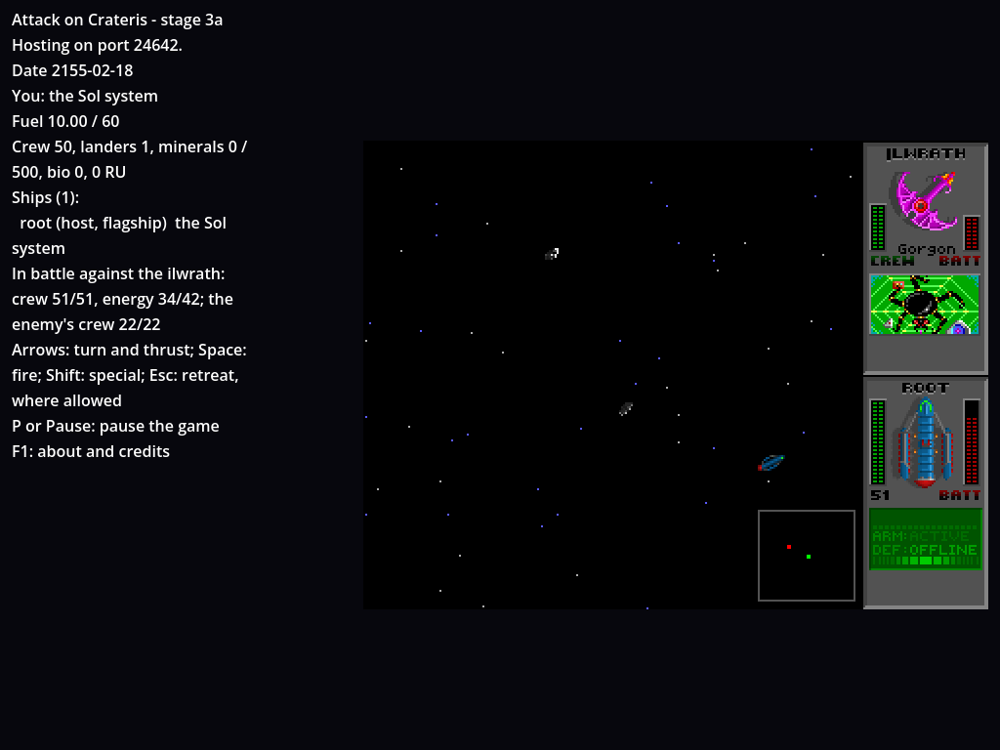
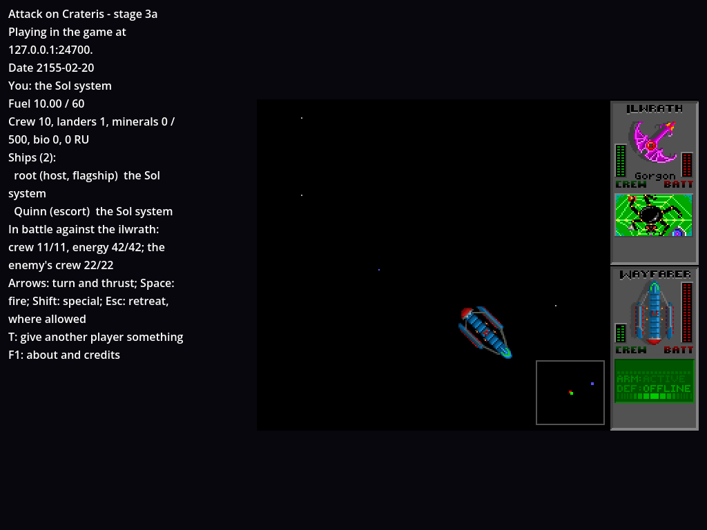

# How to try it: stage 4a, the battle, together

Stage 4a brings UQM's combat, for several players at once. In the opening, the Ilwrath ship's talk ends in a battle by Earth, as in UQM: the player who talked fights it on UQM's battle screen (the arena with its planet and asteroids, the stars, the status panel with each ship's captain, crew and energy), flying their own ship with its own guns against UQM's Ilwrath and its AI. A marker shows the battle by Earth, and the others fly into it to help: each sees the battle from their own ship, with a minimap of the arena. A guest's escort that dies becomes a wreck a friend can revive by flying into it and giving it crew; the flagship's death ends the game for everyone. A battle won pays its salvage, split between the players still in it. After the opening, a player can retreat as in UQM, for five units of their own fuel. The host can pause everything. The engine, the ships, the AI and the drawing are UQM 0.8.0's own, ported and checked frame by frame against recordings of UQM running them. The plan, with every decision, is `docs/plans/stage-4.md`; what differs from UQM is in `docs/differences.md`.



## Set up

As for the content stage (`docs/how-to-try/content-stage.md`):

```
dotnet build game/Crateris.Game.csproj
godot --headless --import --path game
```

## Run the tests

```
CRATERIS_CONTENT=~/Downloads/uqm-0.8.0-content.uqm python3 tools/run_tests.py   # every topic
CRATERIS_CONTENT=~/Downloads/uqm-0.8.0-content.uqm python3 tools/test_network.py
python3 -m unittest discover -s tools/extract                                   # data checks
```

What should happen: every topic passes and none is skipped (1,464 tests in 15 topics). Stage 4a added the topic `combat`; the battle's drawing is in `drawing`. The network test prints `ok` lines ending in "all network checks passed"; one part has a guest join the host's battle through a relay that drops and delays packets, and be sent its battle every frame (about 350 bytes a snapshot). The data checks say `OK (skipped=3)`: the three skipped need the UQM source (`docs/uqm-data.md`).

## Keys

In a battle, as on any flying screen: left and right turn, up thrusts. Space, Enter or Ctrl fires the weapon, Shift the special (the flagship has none; it's for stage 4b's ships), Esc retreats where it's allowed. P or Pause is the host's pause. On the rescue screen: up and down choose the row (the wreck, the crew), left and right change it by one, Page Up and Page Down the crew by ten, Enter (or Space) gives, Esc (or Backspace) closes. On the game over screen, Enter or Esc ends the game. A guest's keys are the same.

## Play it: the Ilwrath at Earth

Start a host at the commander's talk where the Lunar base is reported, the opening's errands done, and a guest that joins it:

```
godot --path game -- --host --name Host --start-visit base-report --save /tmp/ilwrath.json
godot --path game -- --join 127.0.0.1 --name Guest --id guest-1
```

1. **The Ilwrath hails.** The commander's talk is on the host's screen, the guest watching. Reply to him: he warns of the Ilwrath, and the Ilwrath ship hails. Its replies all end in the battle (UQM's `CombatIsInevitable`).
2. **The battle.** As the Ilwrath's reply is said, the host's screen goes to UQM's battle screen: the flagship warps in, the Ilwrath (7 crew of its 22, as UQM's at Earth; it doesn't cloak there) comes for it with its hellfire. The status panel at the right shows the Ilwrath above and the flagship below: their icons, names, crew and energy, and each captain's window, animated as the ship turns, thrusts and fires. The camera zooms between the two ships as UQM's does. The guest's screen shows the Ilwrath's last lines as a notice, and a red ring and cross by the starbase: the battle's marker. There's no retreat from this fight (the starbase isn't available yet).
3. **Flying in.** The guest flies their escort out of the marker's reach and back into it: the escort warps in. Both screens follow their own ship: the host's is UQM's camera, the guest's frames the escort and the Ilwrath the same way. The guest's shots pass through the flagship, and the flagship's through the escort. The minimap in the bottom right corner of the space window shows the arena around the player's own ship: their own dot green, teammates blue, the Ilwrath red.

   

4. **Winning.** The Ilwrath destroyed, the battle ends (it pays no salvage, as UQM's at Earth) and the commander's alliance talk follows, every player watching: the opening goes on as in stage 3a, the two weeks, the starbase ready. The player who started the fight answers if their ship fought to the end; otherwise (wrecked, or gone) the next player present in join order, the host first, and nobody docks as the opening ends.
5. **Losing the escort.** If the escort's crew runs out (the guest flew in, or started the fight by flying into the starbase first and replying), it explodes as UQM's ships do and the guest watches the battle on. Once the battle is over the escort is a wreck by Earth, at the battle's marker: dimmed, still, labelled, its cargo, fuel and modules kept, with no crew. It doesn't fly, land, talk or take gifts.
6. **Everyone out.** If every player is out of the fight with the Ilwrath alive (destroyed or disconnected), the visit is taken back: the starter's ship as before it (a wreck staying a wreck), and the Ilwrath hails again on the next report to the commander.
7. **Losing the flagship** is the game over, whoever else is still fighting: once its explosion and the Ilwrath's victory ditty's time are over, every player's screen fades to black and says the game is over. Enter or Esc ends the game. Nothing is saved from the frame the flagship's crew runs out, so the host's save is the last one made before that (the autosave runs every minute; lost within a new game's first minute, the `--save` file is whatever an earlier run left there, or none): loading it tries again.

## Reviving a wreck

Any player flying free (not in a battle, a talk, orbit or docked) with more than 1 crew can revive a wreck: fly out of its reach and back into it. The ship stops and the rescue screen opens in the status area: the wreck's ship and captain names, how many wrecks are there (left and right choose among them), the rescuer's crew, the wreck's room for crew, and the crew to give, from 1 to the rescuer's less 1, up to the wreck's room. Enter gives it: the wreck flies on with that crew, and both players are told. A refusal says why (another rescuer got there first, too little crew). Esc closes it, and it opens again on flying in again. A wreck's player who is away when it's revived finds their ship back, revived, where it lay.

## A battle after the opening: `--start-battle`

```
godot --path game -- --host --name Host --start-battle ilwrath --save /tmp/battle.json
godot --path game -- --join 127.0.0.1 --name Guest --id guest-1
```

The host starts after the opening (the starbase available, as `--start-docked` leaves it) in flight by Earth, in a battle against an Ilwrath of full crew, which cloaks here, as it does everywhere but the Earth fight, uncloaking as it fires. The guest's escort undocks by the marker, outside the battle, and joins by flying into it (or add `--guests-in-battle` to the host's options: guests joining for the first time warp straight in). Here Esc retreats: the ship flashes red and warps out as UQM's, keeping its crew, and its player pays 5 units of fuel (10 units become 5 for a new game's flagship). A retreated player can't come back into that battle. A disconnect leaves at once, paying the same. Win, and each player still in it gets an equal share of 125 resource units (the Ilwrath's ship cost, 1,000, over 8), the remainder to the first to have joined.

## The host's pause

The host presses P or Pause: the world stops, every battle and the clock with it, and every screen says "PAUSED" ("PAUSED by the host" on a guest's; the host's status says "P or Pause: go on"). P or Pause again goes on. Meanwhile gifts, landings, revivals and the starbase's keys are refused with "The host has paused the game."; a player may still leave or join. `--script`'s `pause` step presses it.

## Save and load

Battles aren't saved. Quit mid-battle (or let the autosave run): on load each player who was in it is back where it started, outside it, with what their ship had when they joined it (its hold and fuel), and the battle is gone. A ship destroyed in a battle, over or still running, loads as a wreck at the battle's place. The Ilwrath's talk, being part of the opening's visit, comes again on the next report. Once the flagship's crew runs out, nothing is saved: the save stays the one from before. Escorts from saves made before stage 4a get their kit's gun on load.

## Shortcuts for testing

As in stage 3a (`docs/how-to-try/stage-3a.md`'s table), and new in 4a:

| Option | What it does |
| --- | --- |
| `--start-visit base-report` | A new game starts in the commander's talk where the Lunar base is reported, the errands done: its replies bring the Ilwrath and its fight |
| `--start-battle RACE` | A new game starts after the opening, the host's ship in flight by Earth in a battle against that race's ship (`data/ships.json`'s id; in 4a only `ilwrath`) |
| `--guests-in-battle` | Guests joining for the first time join the host's battle at once, as if they'd flown into its marker |
| `--script "STEP,STEP"` | As before; `fire` is the weapon, `takeoff` (Escape) a retreat, `special` the special, all held for their frames; `pause` presses the host's pause key |

What should happen with each (each was run this way, headless):

- `--start-visit base-report --script "none:300,select:1,none:400,select:1,none:400"`: the first reply ("We found the base, but it was abandoned years ago."), the Ilwrath hails, its first reply ("Where the hell did you come from?"); the battle starts at about frame 700, the Ilwrath's last lines a notice. Left unflown, the flagship is destroyed: "Battle 1 against the ilwrath lost: ... destroyed", then "Game over: the flagship was lost."
- `--start-battle ilwrath --script "none:40,takeoff:60,none:200" --quit-after 300`: the flagship warps in, retreats, and is out of the battle by frame 190: "You got away."; its fuel is 5 units, from 10.
- `--start-battle ilwrath --script "none:40,pause:1,none:100" --quit-after 140`: "The host paused the game"; the report's `host_paused` is true.
- `tools/test_network.py`: a host with `--start-battle ilwrath --guests-in-battle` and a guest through the lossy relay: the guest is told it joined and is sent its battle every frame.

## The parts, and what checks them

As in stage 3a, UQM's own code is recorded and the port must do the same: the battles run in a recording program (`tools/extract/golden/battle.c`) linked with UQM's real battle engine, its ships and its AI, the drawing, sound and input stubbed, the seed fixed and the keys scripted (`docs/uqm-data.md`).

| Part | Recording | Tests |
| --- | --- | --- |
| The ships' descriptions, the battle's sheets and their collision masks | `battle-masks.json` | `ShipDescriptionTests`, `BattleContentTests` |
| The engine: elements, collisions, gravity, asteroids, explosions, floating crew, weapons, a ship's energy, turning, thrust and firing, dying and warping in | 25 battles, about 20,300 frames (`battle.json`) | `BattleEngineTests` |
| The flagship from its modules and the Ilwrath, its hellfire and cloak | 22 battles (`battle-ships.json`) | `ShipBattleTests`, `SisShipTests` |
| UQM's AI and the Ilwrath's | 25 battles (`battle-ai.json`) | `BattleAiTests`, `CyborgTests` |
| Several player ships: no friendly fire, the bigger arena, the seam, joining, the AI changing target | | `SeveralShipsTests` |
| Battles in the world: markers, joining, retreat, disconnects, story pauses, the end and salvage, the escape counter | | `WorldBattleTests`, `BattleEndTests` |
| Wrecks, revival, game over, saves of version 10 | | `WreckTests` |
| The escorts' combat modules, saves of version 11 | | `OutfittingTests` |
| The Ilwrath fight in the opening | | `OpeningTests` |
| The host's pause | | `HostPauseTests` |
| The wire: the battle sent near each player's ship, the notices, the guest's Special | | `SnapshotCodecTests`, `BattleWireTests`, the network test |
| The battle's screen: the stars, every element, the status panel pixel for pixel, each player's camera, the minimap | two fights' drawing (`battle-draw.json`) | `BattleDrawTests`, `BattleScreenTests` |
| The rescue and game over screens | | `RescueScreenTests` |

The co-op rules UQM can't show are checked by tests of our own: several ships, joining, the shares of salvage and floating crew, wrecks and revival, the game over's timing, the Ilwrath fight with several players.

The recordings can be made again from the UQM source, as for 2b (`docs/how-to-try/stage-2b.md`): `python3 tools/extract/golden_uqm.py --uqm ../uqm-0.8.0/sc2 --content ~/Downloads/uqm-0.8.0-content.uqm`, then `git diff --stat tests/golden` shows no changes.

## What's different from UQM

Each is a row of `docs/differences.md`:

- Several player ships fight one enemy ship at a time, and don't hit each other (rows 5 and 48); others join by flying into the battle's marker (row 15).
- Each player has their own camera and a minimap, in an arena 1.5 times UQM's each way (rows 6 and 7); collisions are measured across the arena's seam (row 49).
- A ship that dies is a wreck at the battle's marker once it's over, revived by a friend's crew (rows 8 and 54); the flagship's death ends the game for everyone, at UQM's time (row 50).
- Retreat is per player; a disconnect leaves at once, paying the fuel, even from the Ilwrath fight (rows 4 and 52).
- Salvage is split between the players still in the battle (row 18); floating crew is shared between a side's ships (row 53).
- The Ilwrath fight is the starter's, others may help, and what happens when they're wrecked or gone (row 55).
- Battles aren't saved, and gifts wait while a player is in one (row 51); escorts have combat modules (row 9) and saves are version 11 (row 13).
- Story pauses and the host's pause freeze battles; the clock runs on in battles (rows 1, 2 and 12).
- The escape counter keeps a ship leaving a battle from the worlds and the starbase too (row 56); a battle's planet and random numbers are its own (row 57).
- The battle's pixels are scaled by nearest pixels, not UQM's smooth blend, until a visual-fidelity pass (row 58).

## Known limits of stage 4a

- **One enemy, one race:** only the Ilwrath can be fought; the other 24 race ships, the enemy's fleets and the host's AI fleet (the shipyard's fleet ships, the Arilou's gift) come with stage 4b. Nothing in space but the Ilwrath at Earth starts a battle before stage 3b.
- **No sound:** no battle sounds, music or victory ditties.
- **Visual fidelity:** the smooth zoom's stamps are sharper than UQM's (row 58), and the minimap's place may move.
- **The Sa-Matra** and the final battle come with the endgame, after stage 3c.

## Bugs

Send the error text, a screenshot and what you expected. The terminals print what happened, including each battle's start and end ("Battle 1 against the ilwrath lost: ... retreated") and the notices each player is given. Add `--report FILE` to get it as JSON, with the battle as last sent and its notices.
