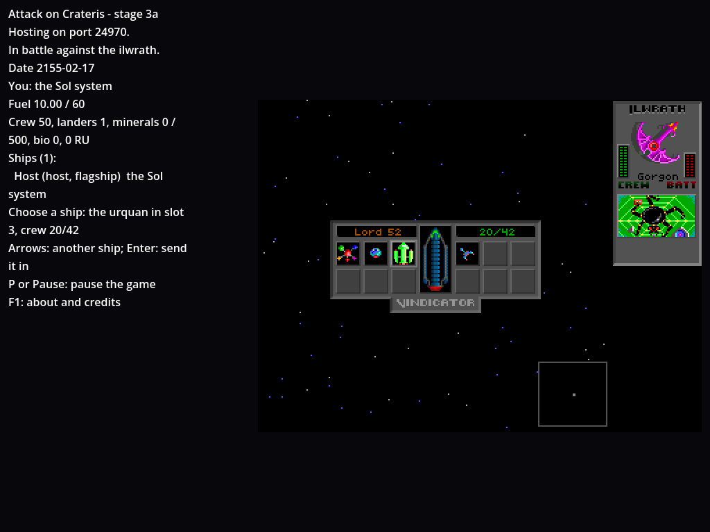
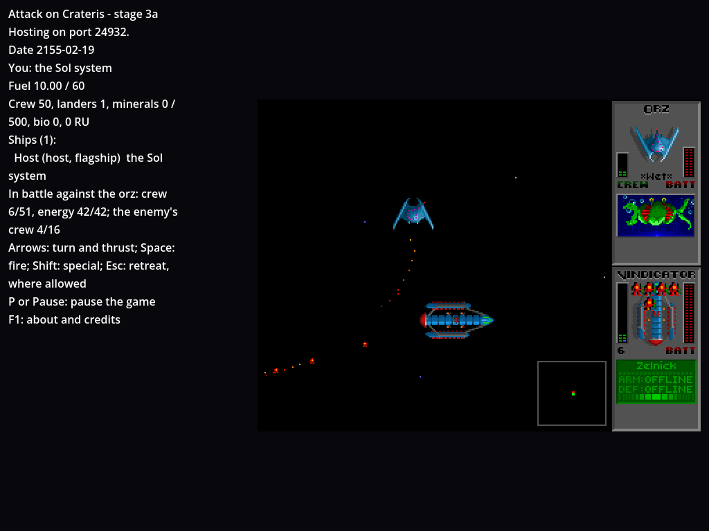
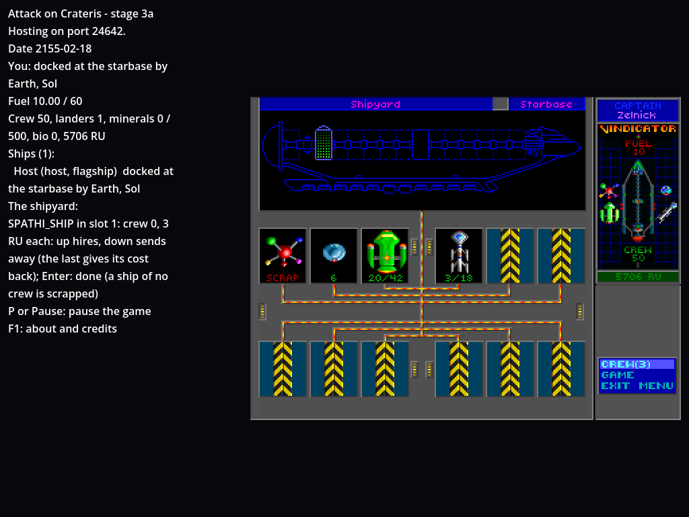
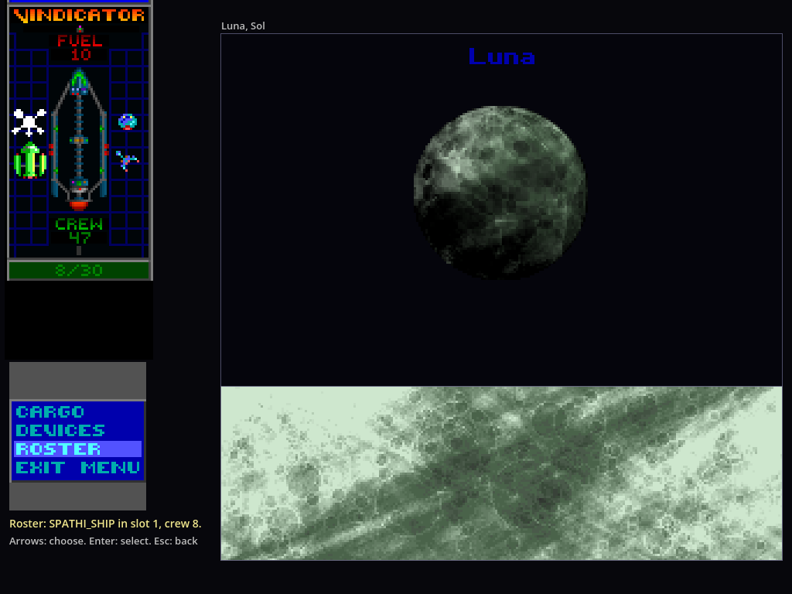

# How to try it: stage 4b, every race's ship and the host's fleet

Stage 4b brings the other 24 race ships of UQM and the host's fleet. Every race's ship flies, fires, uses its special and is flown by the computer as UQM's is, checked frame by frame against recordings of UQM running each one, as the enemy and in a player's hands. A battle can be against an enemy fleet of several ships, of one race or more, which warp in one at a time; a win pays the first ship's race's bounty for each one destroyed, as UQM's does. The host has UQM's fleet of escort ships: built, crewed and scrapped at the shipyard as in UQM, crew moved between them and the flagship with the roster, and in a battle the host chooses on UQM's pick screen which ship to send in and flies it, the flagship the last choice. Ships that touch other ships (the Orz's marines, the Syreen's song, the Shofixti's Glory Device, the VUX's limpets and the rest) work with several players by stage 4's rules. Only the host has a fleet; guests fly their own ships, as in 4a. The plan, with every decision, is `docs/plans/stage-4b.md`; what differs from UQM is in `docs/differences.md`.

Before stage 3b nothing in space starts these battles (only the Ilwrath at Earth does), and only the Earthlings are allied, so most of this stage is tried with testing shortcuts, as 4a's `--start-battle`.



## Set up

As for the content stage (`docs/how-to-try/content-stage.md`):

```
dotnet build game/Crateris.Game.csproj
godot --headless --import --path game
```

## Run the tests

```
CRATERIS_CONTENT=~/Downloads/uqm-0.8.0-content.uqm python3 tools/run_tests.py   # every topic
CRATERIS_CONTENT=~/Downloads/uqm-0.8.0-content.uqm python3 tools/test_network.py
python3 -m unittest discover -s tools/extract                                   # data checks
```

What should happen: every topic passes and none is skipped (2,143 tests in 16 topics). Stage 4b added the topic `fleet` (the host's fleet, the shipyard, the roster, fleet ships in battle and on the wire); the race ships are in `combat`, their drawing in `drawing`. The network test prints `ok` lines ending in "all network checks passed"; two of its parts are new: a host with fleet ships picks one while a guest fights (below), and a guest collects the VUX's limpets through a relay that drops and delays packets, its snapshots measured. The data checks say `OK (skipped=3)`: the three skipped need the UQM source (`docs/uqm-data.md`).

## Keys

In a battle, as in 4a: left and right turn, up thrusts, Space, Enter or Ctrl fires the weapon, Shift the special (every race ship has one: the Arilou's teleport, the Spathi's B.U.T.T., the Ur-Quan's fighters, ...), Esc retreats where it's allowed. On the pick screen: the arrows move the cursor round the hangar's two rows of six and the flagship between them, Enter sends in the ship under it. At the shipyard: the arrows move round the hangar's slots and the flagship, Enter on an empty slot opens the list of ships to build (the arrows choose, Enter builds, Esc goes back), Enter on a ship edits its crew (up hires, down sends away, Enter is done). In orbit, the Manifest's Roster: the arrows choose a ship, Enter edits its crew (up moves one from the flagship to it, down one back, Enter is done), Esc goes back. The status lines say which keys work where. `--script`'s `menuleft` and `menuright` are the menus' left and right (the arrows on the keyboard), as `left` and `right` are the ship's.

## Every race's ship: `--start-battle RACE`

```
godot --path game -- --host --name Host --start-battle orz --save /tmp/battle.json
godot --path game -- --join 127.0.0.1 --name Guest --id guest-1
```

As in 4a, the host starts after the opening, in flight by Earth, in a battle against a ship of that race with its race's starting crew; the guest's escort undocks by the marker and joins by flying into it (or add `--guests-in-battle` to the host's options). RACE is `data/ships.json`'s id, UQM's folder name: `ilwrath`, `arilou`, `spathi`, `supox`, `druuge`, `yehat`, `zoqfot`, `thradd`, `umgah`, `utwig`, `mycon`, `androsyn`, `mmrnmhrm`, `chenjesu`, `slylandr`, `urquan`, `blackurq` (the Kohr-Ah), `human` (the Earthling), `syreen`, `pkunk`, `vux`, `shofixti`, `chmmr`, `melnorme`, `orz`. Any other is refused with the list ("Can't start there: nonesuch isn't a ship that can be fought (ported: ilwrath, arilou, ...)").



1. **The ship.** It warps in and fights as UQM's, with its own AI. The status panel shows it as UQM's does: its icon, name, captain, crew and energy, and its captain's window animated as it turns, thrusts and fires. The battle's marker, for the players outside it, shows the race: a red ring with the ship's icon and "battle: Spathi" (the race's name).
2. **What ships do to each other's panels.** The Orz's marines that board a ship stand on its icon in its panel, as above, and go as they die; the VUX's limpets stick to it there, slowing it. A Shofixti's Glory Device steps its captain's window on each press and release of the special and blows up on the third press (see the fleet battle below: the host can fly one).
3. **Several players.** The ships that act on others follow stage 4's rules (decision 6): a ship that picks one target takes the nearest opposing ship, area effects hit every opposing ship in range and spare teammates. An enemy Syreen's song takes crew from every player ship in reach, and any ship can pick the floating crew up; the Orz's marines go for the nearest player ship and kill its crew aboard whatever its teammates can do; the Shofixti's Glory Device spares its teammates; the Earthling's and Chmmr's point defence leave teammates be; the Melnorme's confusion confuses each player it hits.
4. **Retreat, salvage, losing** are 4a's: Esc retreats for 5 units of fuel, a win pays the race's ship cost over 8 split between the players still in it, the flagship's death ends the game.

## Enemy fleets: `--start-battle RACE,RACE,...`

Up to 14 ships, of one race or several. The first warps in; when it dies, the next warps in, and so on. A win, once the last is dead, pays the first ship's race's bounty (its ship cost over 8) for every enemy ship destroyed, whatever their own races, split as in 4a: `urquan,spathi,spathi` pays 3 times 375. A first race with no fleet in the full game (`androsyn`, `chenjesu`, `mmrnmhrm`) pays nothing, as UQM's shows no tally. A battle lost or fled pays nothing for the ships destroyed in it. The marker shows the first ship's race the whole battle (the encounter's race). A guest can fly in while a ship that isn't the last is dying.

## The host's fleet in a battle

```
godot --path game -- --host --name Host --start-fleet spathi:5,arilou,urquan:20,vux --start-battle ilwrath --save /tmp/fleet.json
```

`--start-fleet` gives the host's fleet these ships (up to 12, each `SHIP` or `SHIP:CREW`, the race's starting crew if none), each with a captain named as UQM names one. With a fleet, the battle opens on UQM's pick screen, over the battle: the hangar's twelve slots in two rows with the flagship between them, its name below, each fleet ship's icon in its slot, the ship under the cursor flashing with its captain and crew (`20/42` for an Ur-Quan short of its 42) at the top. The status lines say it too: "Choose a ship: the urquan in slot 3, crew 20/42".

1. **Choosing.** Enter sends the ship under the cursor in; the host flies it as their own ship (their camera, the status panel, the enemy's target). Choosing the flagship is the last choice: the fleet ships can't be picked after it.
2. **Its death or retreat.** When it dies or retreats, the pick screen opens again: a ship destroyed is marked with an X and gone from the fleet for good; one that retreated is shown filled blue, keeps its crew, and can't be picked again in that battle. When the host's last ship leaves (the flagship retreating), the flagship pays the 5 units of fuel. The flagship's death is still the game over.
3. **Alone or not.** With nobody else fighting in it, the battle waits while the host chooses, as UQM's does. With a guest fighting, it runs on behind the pick screen, and the guest's status lines say "Host is choosing their next ship."; a guest flying in while it waits joins once the host has chosen. The host on the pick screen is in the battle: it isn't lost meanwhile, and if the enemy's last ship dies, it's won, the pick screen closes and the host has a share.
4. **Salvage** is one share per player in the battle when it's won, whatever ship they fly.
5. **After the battle,** each fleet ship has the crew it ended with (a Syreen may come back with more than it started with). A save during the battle has the fleet as it joined, without the ships destroyed meanwhile.

## The shipyard

```
godot --path game -- --host --name Host --start-docked --start-allied spathi,arilou --start-fleet spathi:5,arilou,urquan:20 --start-units 5000 --save /tmp/yard.json
```

`--start-allied` makes those ships' races allied, so the shipyard builds their ships (the Earthlings are always allied). At the shipyard the hangar's doors open on the fleet ships, each with its crew count below it (`5/30` short of its most, `6` full), and the status area at the right shows them round the flagship; Crew puts the cursor in the hangar.



1. **Building.** Enter on an empty slot opens the list of the allied races' ships: the ship lit, its name and its cost in the status area ("Build into slot 4: HUMAN_SHIP" in the status lines). Enter builds it into that slot from the host's resource units: its doors open on it, with one crew, and its crew editing begins.
2. **Crewing.** On a fleet ship, up hires crew at the group's crew price, down sends crew away for UQM's refund, up to its race's most.
3. **Scrapping.** Sending the last crew away gives the ship's cost back and shows SCRAP; hiring again buys it back at its cost; Enter with it at no crew scraps it, its doors closing over it.
4. **Guests** at the shipyard see the host's fleet in the hangar as it changes, and crew their own ship as in 3a; Enter on a hangar slot is refused (they have no fleet).

The ship spin (UQM's special key on a ship) isn't built: the official content has no spin pictures (`differences.md` row 63).

## The roster in orbit

```
godot --path game -- --host --name Host --start-orbit 82:2:1 --start-fleet spathi:5,arilou:6,urquan:20,vux --save /tmp/roster.json
```

In orbit round Luna, the orbit menu's Manifest, then Roster: UQM's status area shows above the menu box, the flagship with its crew and the fleet's ships round it, the one lit flashing, its crew below. Enter on a ship edits its crew: up moves a crew member to it from the flagship, down one back, each within its most (a ship that has more than its race's starting crew, a Syreen that picked some up, can give crew back but take none). Esc goes back to the Manifest. Only the host has a roster; a guest's Roster still says "(later)".



## The Arilou's gift

Once the portal spawner is found, the commander's next bulletin brings three Arilou ships into the host's fleet, whoever is talking to him (a guest too), if it has room; with no room the news waits. No shortcut reaches it yet: `--start-docked` marks every bulletin as told, and `--start-devices PORTAL_SPAWNER_DEVICE` puts the device aboard without the story's `PORTAL_SPAWNER` field that the bulletin reads, so the commander only greets ("Ah, Captain Zelnick, I'm glad you're back.") and the fleet stays empty. `FleetTests` checks the gift: three Arilou of 6 crew in the first free slots, their captains named as UQM's talk names them, given once.

## Save and load

The host's fleet is saved with each ship's race, crew, captain and hangar slot (saves of version 12; an older save loads with no fleet). `--start-fleet` and `--start-allied`, like `--start-units`, change whatever game is loaded and are saved with it.

## Together: the network

```
godot --path game -- --host --name Host --start-fleet spathi:5,arilou --start-battle ilwrath --guests-in-battle --save /tmp/fleet.json
godot --path game -- --join 127.0.0.1 --name Guest --id guest-1
```

The guest joins the host's battle (at once, `--guests-in-battle`) once the host has chosen. Every player is sent the host's fleet (in the host's ship, for their hangar), the marker's race, and in the battle the host's fleet ships and the pick screen's cursor; the host's choices, shipyard and roster run in the host's own game, so none of them is a message. While the host chooses, the guest fights on and is told in words; the pick screen is drawn for the host only.

## Shortcuts for testing

As in stages 3a and 4a (`docs/how-to-try/stage-3a.md`'s and `stage-4a.md`'s tables), and new or changed in 4b:

| Option | What it does |
| --- | --- |
| `--start-battle RACE[,RACE...]` | A new game starts after the opening, the host's ship in flight by Earth in a battle against these ships, one at a time, by `data/ships.json`'s id (the 25 race ships listed above); up to 14. With fleet ships the host chooses each on the pick screen |
| `--start-fleet SHIP[:CREW][,SHIP[:CREW]]` | The host's fleet is these ships, up to 12, by `data/ships.json`'s id, each with that crew (1 to its most) or its race's starting crew; not `androsyn`, `chenjesu` or `mmrnmhrm`, races with no fleet |
| `--start-allied SHIP[,SHIP]` | These ships' races are allied, so the shipyard builds their ships |
| `--script "STEP,STEP"` | As before; `menuleft` and `menuright` press the menus' left and right once; the menu keys work the pick screen, the shipyard's hangar and its list, and the roster too |

`--start-fleet` and `--start-allied` with no option that puts the host somewhere change the default game (`host-save.json`) and are saved with it: give them a `--save` file when trying.

What should happen with each (each was run this way, headless, as the host, with a `--save` file but the first):

- `--start-battle nonesuch --quit-after 30`: "Can't start there: nonesuch isn't a ship that can be fought (ported: ilwrath, arilou, spathi, supox, druuge, yehat, zoqfot, thradd, umgah, utwig, mycon, androsyn, mmrnmhrm, chenjesu, slylandr, urquan, blackurq, human, syreen, pkunk, vux, shofixti, chmmr, melnorme, orz)", and a new game in hyperspace.
- `--start-fleet spathi:5,arilou --start-battle ilwrath --script "none:20,menuleft:1,menuleft:1,select:1,none:40,takeoff:180,select:1,none:40,takeoff:200,none:20" --quit-after 520`: "Starting with a fleet of 2 (spathi, arilou)", then "Picked the arilou in slot 2, crew 6" (two lefts from the flagship), which retreats; on the pick screen again Enter takes the flagship ("Picked the flagship, crew 50"), which retreats: "You got away." The flagship's fuel is 5 units, from 10; the fleet (the `--report` file's `fleet`, and the save's) is the Spathi of 5 and the Arilou of 6.
- `--start-fleet spathi:5,arilou,urquan:20,vux --start-battle ilwrath --script "none:20,menuleft:1,none:10" --quit-after 40`: the pick screen, the Ur-Quan in slot 3 lit ("Choose a ship: the urquan in slot 3, crew 20/42"), as the picture above (that one with a display, `--screenshot`).
- `--start-fleet urquan --start-battle umgah,shofixti --script "none:20,menuleft:1,none:2,menuleft:1,none:2,menuleft:1,none:2,select:1,none:20,fire+special:2400" --quit-after 2500`: "Starting in a battle against a fleet of 2 (umgah, shofixti) by Earth", "Picked the urquan in slot 1, crew 42"; the Umgah dies and the Shofixti warps in: at the end the report's battle is against the shofixti, the Ur-Quan at 35 crew.
- `--start-fleet shofixti --start-battle ilwrath --script "none:20,menuleft:1,none:2,menuleft:1,none:2,menuleft:1,none:2,select:1,none:40,special:2,none:4,special:2,none:4,special:2,none:4,none:80" --quit-after 200`: the Shofixti picked, three presses of the special blow it up; the report's fleet ship is `Destroyed`, the pick screen open again with only the flagship, and the fleet empty. Two presses leave it whole.
- `--start-orbit 82:2:1 --start-fleet spathi:5,arilou:6,urquan:20,vux --script "none:10,down:1,none:3,down:1,none:3,select:1,none:5,down:1,none:3,down:1,none:3,select:1,none:10,select:1,none:5,up:1,none:3,up:1,none:3,up:1,none:5,select:1,none:30" --quit-after 120`: Manifest, Roster, the Spathi's crew, three moved to it: the Spathi 8, the flagship 47.
- `--start-docked --start-allied spathi,arilou --start-fleet spathi:5,arilou,urquan:20 --start-units 5000 --script "none:12,down:1,none:3,down:1,none:6,select:1,none:12,select:1,none:30,down:1,none:3,menuright:1,none:3,menuright:1,none:3,menuright:1,none:6,select:1,none:6,menuright:1,none:6,select:1,none:30,up:1,none:3,up:1,none:6,select:1,none:6,menuleft:1,none:3,menuleft:1,none:3,menuleft:1,none:6,select:1,none:6,down:1,none:3,down:1,none:3,down:1,none:3,down:1,none:3,down:1,none:6,select:1,none:60" --quit-after 300`: Shipyard, Crew, down to the first slot, right to the fourth, empty: the list (the Arilou first), right to the Earthling cruiser, built for 1,100, two crew hired; back to the Spathi, its five crew sent away (the last gives its 1,800 back), Enter scraps it. The fleet is the Arilou 6, the Ur-Quan 20 and the cruiser 3 in slot 4; 5,706 resource units.
- `--start-docked --start-devices PORTAL_SPAWNER_DEVICE --script "none:12,select:1,none:900" --quit-after 900`: the commander's greeting, no bulletin, the fleet empty (see the Arilou's gift above).
- Save and load: `--start-orbit 82:2:1 --start-fleet spathi:5,arilou --save FILE --quit-after 60`, then `--host --load FILE --save FILE --quit-after 30`: the save is version 12, and the loaded game's fleet is the Spathi of 5 in slot 0 and the Arilou of 6 in slot 1, their captains as saved. (With `--load` alone the host goes on saving to `host-save.json`, over the default game.)
- The network, as `tools/test_network.py` runs it: the host with `--id host --start-fleet spathi:5,arilou --start-battle ilwrath --guests-in-battle --script "none:60,menuleft:1,menuleft:1,select:1,none:40,takeoff:150,none:400" --quit-after 420` and a guest with `--join 127.0.0.1 --id guest-1 --quit-after 330`: the host logs "Picked the arilou in slot 2, crew 6" as the guest joins the battle ("In battle against the ilwrath."). At the end the guest's report has the host's fleet in the host's ship (the Spathi of 5 in slot 0, the Arilou of 6 in slot 1), the marker's race (`ilwrath`), and the host on the pick screen with the Arilou `Retreated` and the Spathi to pick.
- `tools/test_network.py`'s limpets part: a host with `--start-battle vux --guests-in-battle` and a guest through the lossy relay flying at the VUX. It prints the most marks one ship carried in a snapshot the guest was sent and what the snapshots cost, which must stay under 1,500 bytes; on one run: "limpets: up to 5 marks on one ship in a snapshot S was sent (0 on S's own); 478 with its battle, 321 bytes a snapshot, 633 the most" (the relay's losses change the figures a little from run to run).

## The parts, and what checks them

As in 4a, UQM's own code is recorded and the port must do the same: each race ship's battles run in the recording program (`tools/extract/golden/battle.c`) with UQM's real battle engine, ships and AI, the seed fixed and the keys scripted; the shipyard and the roster in its outfitting program (`tools/extract/golden/outfit.c`); the drawing in its screens program (`docs/uqm-data.md`).

| Part | Recording | Tests |
| --- | --- | --- |
| Every race ship's graphics at three sizes, captain's windows and masks; the recordings' shape | `battle-races-1.json` to `-3.json` | `BattleContentTests`, `RaceBattleTraceTests` |
| The 24 race ships and their AIs | 49 battles: each ship against the flagship, by scripted keys and with both flown by UQM's AI, and a Pkunk's rebirth (`battle-races-1.json` to `-3.json`) | `RaceShipBattleTests` |
| The ships that act on other ships, with two and four players; each flown by a player | | `RaceShipCoopTests` |
| Enemy fleets: one ship at a time, infinite fleets, the salvage, the crews left, `--start-battle RACE,RACE` | | `EnemyFleetTests`, `BattleScreenTests` |
| The host's fleet: `build.c`'s functions, captains' names, the talks' ships, the Arilou's gift, saves of version 12, `--start-fleet` and `--start-allied` | | `FleetTests` |
| The shipyard (building, crewing, scrapping) and the roster | 81 shipyard scenarios (`outfit.json`'s `shipyard`) | `ShipyardGoldenTests`, `ShipyardTests` |
| Fleet ships in battle: the pick screen, deaths and retreats, the battle waiting, the fuel, salvage, saves | | `FleetBattleTests` |
| The wire: the host's fleet, the markers' race, the host's fleet ships and pick screen in the battle, the captain's windows' marks | | `FleetWireTests`, `SnapshotCodecTests`, `RaceShipBattleTests` (every frame through the codec), the network test |
| Every race ship's status panel and captain's window, its sprites | the 24 ships' keys battles and the Pkunk's rebirth, drawn (`battle-races-draw.json`) | `RaceDrawTests`, `BattleScreenTests` |
| The pick screen, the shipyard's hangar and list, the roster | 25 scenarios (`screens.json`) | `StarbaseScreensTests`, `ShipyardTests` |

The co-op rules UQM can't show are checked by tests of our own: the ships that act on others with several players, the pick screen with others fighting, only the host's fleet, a guest's view of it.

The recordings can be made again from the UQM source, as for 4a: `python3 tools/extract/golden_uqm.py --uqm ../uqm-0.8.0/sc2 --content ~/Downloads/uqm-0.8.0-content.uqm` (`--only battle-races` takes about two minutes), then `git diff --stat tests/golden` shows no changes.

## What's different from UQM

Each is a row of `docs/differences.md`:

- Only the host has a fleet, flies its ships and changes it; a talk's ships go into it whoever answers; guests fly their own ships (row 65, with rows 9, 43 and 44 closed).
- The host chooses on the pick screen as UQM's player does; the battle waits only while nobody else fights in it, and the host choosing is in it (row 61). A held arrow moves the cursor once, and a held fire key picks nothing.
- A fleet ship that dies is gone, as in UQM (row 8); the salvage is one share per player, with an enemy fleet's paid as UQM's (row 18); the host disconnecting while flying a fleet ship takes it out with its crew (row 4).
- Enemy fleets come one ship at a time, as UQM's (row 5); a battle can be joined while an enemy ship that isn't its last is dying, and its marker shows its race (row 15).
- The ships that act on others, with several players (rows 48, 53, 59 and 60); their contact and aim are measured across the seam (row 49).
- The shipyard's hangar with several players (row 62); the ship spin isn't built (row 63, temporary); the roster draws UQM's status area above the orbit menu while it's open (row 64, temporary).
- A save during a battle has the fleet as it joined it, without the ships destroyed (row 51); saves are version 12 (row 13).
- The Shofixti's one-frame centre pixel in the battle's nearest-pixel scaling (row 58, temporary).

## Known limits of stage 4b

- **Nothing in space starts these battles** before stage 3b (ships in space, the races' talks, their alliances and the ships they give and take): only the Ilwrath at Earth, and the testing shortcuts. Only the Earthlings are allied without `--start-allied`.
- **The Arilou's gift has no shortcut** to try it by hand (above); its test runs it.
- **The roster** is only in the orbit menu's Manifest, as the hyperspace and system menus come later; the flight screens show the status in words otherwise (row 64).
- **Infinite fleets** (3b's homeworlds) and the enemy's crews left after a battle lost are built for 3b, with no shortcut.
- **The Shofixti** is the recruited one; Tanaka's damaged scout comes with 3b's encounter.
- **No sound:** no battle sounds, music, victory ditties or the Pkunk's insults.
- **Visual fidelity:** the smooth zoom's stamps are sharper than UQM's (row 58), and the minimap's place may move.
- **The Sa-Matra** and the final battle come with the endgame, after stage 3c.

## Bugs

Send the error text, a screenshot and what you expected. The terminals print what happened, including each battle's start and end, each ship picked ("Picked the arilou in slot 2, crew 6") and the starbase's keys. Add `--report FILE` to get it as JSON, with the battle as last sent (the host's fleet ships in it, `armadas`) and the host's fleet (`fleet`).
